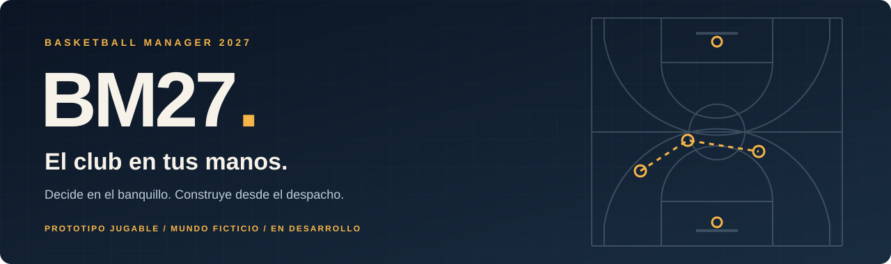
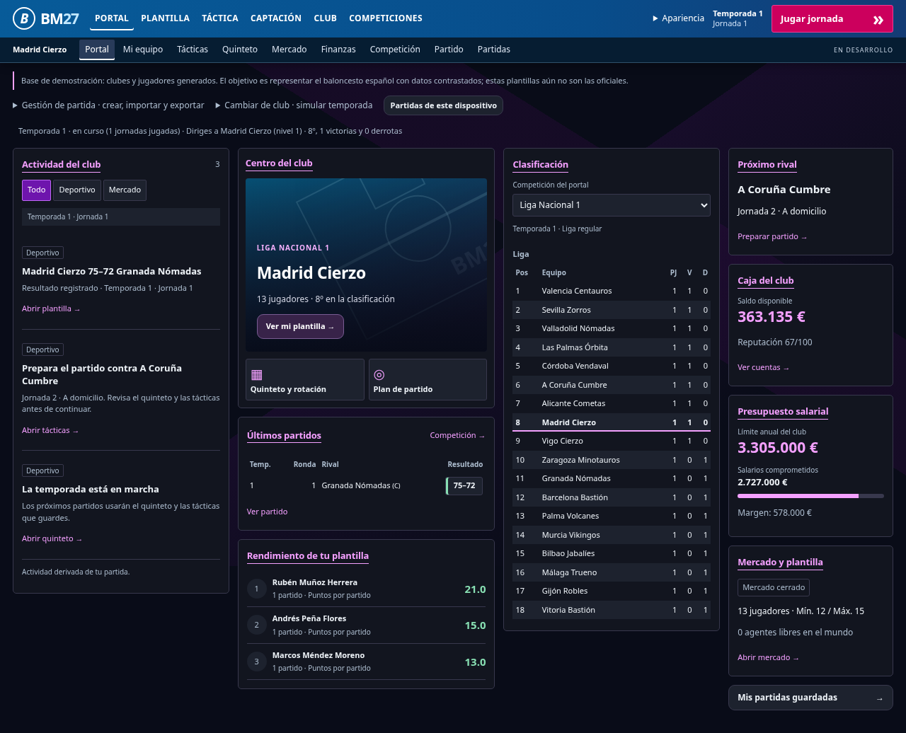
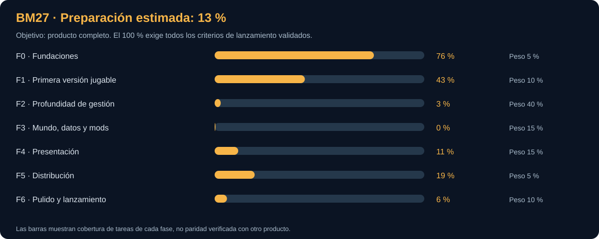
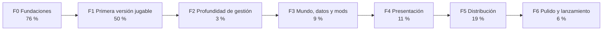
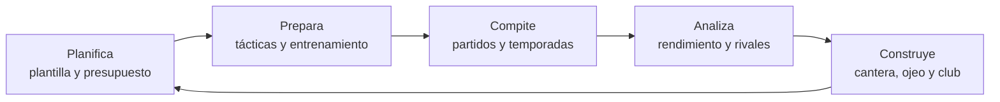

# BM27 — Basketball Manager 2027

  

<strong>Gestiona baloncesto. Construye un club. Compite durante generaciones.</strong>

  <a href="#descargar-para-windows">Descargar</a> ·
  <a href="#estado-real-del-juego">Estado real</a> ·
  <a href="#avance-del-desarrollo">Preparación</a> ·
  <a href="docs/roadmap.md">Plan completo</a> ·
  <a href="#cómo-probar-bm27">Probar BM27</a> ·
  <a href="docs/desarrollo.md">Desarrollar</a>

**BM27 — Basketball Manager 2027** es el título definitivo de un simulador de gestión de baloncesto
para PC. El proyecto combina decisiones deportivas, gestión de club y un mundo deportivo que evoluciona
con las temporadas. El objetivo es un gestor deportivo profundo, explicable y duradero.

> **Prototipo temprano y jugable.** El nombre es definitivo; el producto aún está lejos de una versión
> comercial completa. Repositorio privado y comercial: [licencia](LICENSE). La cabecera es una
> ilustración de marca, no una captura del juego.

## Descargar para Windows

**[⬇ Descargar BM27 v0.1.0-alpha.1 para Windows (.exe, 1,4 MB)](https://github.com/dariogea/BM27/releases/download/v0.1.0-alpha.1/BM27_0.1.0-alpha.1_x64-setup.exe)**

Versión **alfa** ([todas las versiones](https://github.com/dariogea/BM27/releases)). Pasos:

1. Entra en GitHub con tu cuenta (el repositorio es privado: sin sesión el enlace da «404»).
2. Pulsa el enlace de arriba: se descarga `BM27_0.1.0-alpha.1_x64-setup.exe`.
3. Ábrelo con doble clic. Se instala solo para tu usuario, sin permisos de administrador.
4. Si Windows dice **«Windows protegió su PC»**, pulsa **«Más información»** y **«Ejecutar de todos modos»** (el instalador no está firmado con un certificado de pago).
5. Abre **BM27** desde el menú Inicio. Arriba verás la franja del launcher con la versión y la búsqueda de actualizaciones.

Comprobación opcional: la huella SHA-256 del archivo es
`c1aecb59ce83023a8a39170933f86e467ffaa719d47cf40c09098b67b3430e92`.

**Limitaciones:** los clubes y jugadores son generados; nadie ha ejecutado aún este instalador en un Windows real; la
comprobación de actualizaciones necesita un token de lectura mientras el repositorio sea privado
(ver [`docs/escritorio.md`](docs/escritorio.md)).

## Estado real del juego

| Sistema        | Qué existe hoy                                                                                                                | Qué falta para el objetivo completo                                                              |
| -------------- | ----------------------------------------------------------------------------------------------------------------------------- | ------------------------------------------------------------------------------------------------ |
| Partido        | Simulación por posesiones, tácticas con efecto y estadísticas derivadas de eventos.                                           | Entrenadores con criterio, más reglas, lesiones, tiempos muertos y calibración contrastada.      |
| Club y mercado | Equipo propio, quinteto, agentes libres, contratos, salarios y cuentas del club.                                              | Traspasos negociados, personal, instalaciones, patrocinadores y decisiones económicas profundas. |
| Mundo          | Cuatro niveles, temporadas, ascensos, descensos, desarrollo y retiradas.                                                      | Cantera real, ojeo, competiciones adicionales y mayor estabilidad contrastada.                   |
| Experiencia    | Buscador y fichas de jugadores/clubes; demo con temas claro/oscuro, inicio guiado, diseño para PC y compilación para Windows. | Ayuda completa, validación de todas las pantallas y pruebas de instalación real.                 |
| Partidas       | Archivos con checksum, ranuras internas y autoguardado al terminar la temporada.                                              | Recuperación con copias históricas y un historial más completo.                                  |

Los entrenadores y la entrada de jóvenes siguen usando reglas provisionales (`PLACEHOLDER`).
Las escalas de salarios y las bandas estadísticas son aproximaciones. No se presentan como sistemas
terminados de un juego comercial.

**Plataforma objetivo: solo PC.** La interfaz se valida a distintas resoluciones de escritorio; no se desarrolla una versión móvil.

**Nueva dirección de datos:** [España como referencia real y catálogo de fuentes](docs/datos/espana.md). Las plantillas actuales siguen siendo generadas hasta contrastar las oficiales.

## Así se ve la demo

[Ver el portal de PC, modo claro y distintas resoluciones](docs/revisiones/portal-52.md). Las capturas muestran datos generados de la demo.

## La referencia del 100 %

La referencia de diseño es la profundidad de gestión de **Football Manager**, adaptada al baloncesto:
una carrera completa, decisiones conectadas, rivales competentes, un mundo sostenible y una experiencia
lista para jugadores. No disponemos de una auditoría de su desarrollo interno para medir una paridad exacta.

El índice de preparación de BM27 pondera las fases por su importancia para ese producto. El bloque
de profundidad de gestión pesa un **40 %**; completar documentación o cimientos técnicos no equivale a
terminar la experiencia. Los pesos son hipótesis de planificación publicadas, no horas medidas.

<!-- roadmap:start -->

## Avance del desarrollo

**Preparación estimada para lanzamiento: 14 %** `████░░░░░░░░░░░░░░░░░░░░░░░░░░`

475 elementos organizados en 7 fases y 34 áreas de desarrollo. El índice pondera la profundidad y el producto terminado; no es una comparación medida con otro juego ni una fecha de entrega.

Las barras de fase muestran cobertura del plan; el índice global usa pesos distintos. [Ver pesos y criterios del 100 %](docs/roadmap.md#objetivo-del-100-).

- **F0 · Fundaciones**: 76 % `███████████████░░░░░`
- **F1 · Primera versión jugable**: 50 % `██████████░░░░░░░░░░`
- **F2 · Profundidad de gestión**: 3 % `█░░░░░░░░░░░░░░░░░░░`
- **F3 · Mundo, datos y mods**: 9 % `██░░░░░░░░░░░░░░░░░░`
- **F4 · Presentación**: 11 % `██░░░░░░░░░░░░░░░░░░`
- **F5 · Distribución**: 19 % `████░░░░░░░░░░░░░░░░`
- **F6 · Pulido y lanzamiento**: 6 % `█░░░░░░░░░░░░░░░░░░░`

**[Ver el roadmap completo: tareas, responsables y pendientes](docs/roadmap.md)**

<!-- roadmap:end -->

## La experiencia que estamos construyendo

Este es el ciclo objetivo. **Todavía está incompleto**: el entrenamiento, el ojeo y varias decisiones
de club siguen pendientes en el roadmap.

## Cómo probar BM27

**Windows:** hay una compilación de prueba en los artefactos de GitHub Actions; todavía no hay una
Release publicada. Necesitas acceso al repositorio. La instalación y los diálogos nativos aún deben
validarse en un Windows real.

**[Guía de descarga e instalación →](docs/escritorio.md#probar-sin-esperar-a-una-versión-publicada)**

**Desarrollo:** con Node.js 22 o superior y pnpm puedes arrancar la web y probar el prototipo.
La guía conserva los comandos, el recorrido de una partida y las comprobaciones.

**[Ejecutar y desarrollar BM27 →](docs/desarrollo.md)**

**[Cómo usar los guardados internos y las copias en archivo →](docs/partidas.md)**

**[Consultar jugadores y clubes desde Mundo →](docs/consultas.md)**

## Explorar el proyecto

| Producto y planificación                                 | Funcionamiento                                                                     | Desarrollo y seguimiento                 |
| -------------------------------------------------------- | ---------------------------------------------------------------------------------- | ---------------------------------------- |
| [Roadmap completo](docs/roadmap.md)                      | [Arquitectura](docs/arquitectura.md)                                               | [Guía de desarrollo](docs/desarrollo.md) |
| [Criterios del 100 %](docs/roadmap.md#objetivo-del-100-) | [Efecto de las tácticas](docs/tacticas.md)                                         | [Estado de entregas](docs/estado.md)     |
| [Identidad y descripción](docs/identidad.md)             | [Aplicación de Windows](docs/escritorio.md)                                        | [Decisiones](docs/decisiones.md)         |
| [Índice de documentación](docs/README.md)                | [Validación automática](https://github.com/dariogea/BM27/actions/workflows/ci.yml) | [Coordinación](docs/coordinacion.md)     |

---

El desarrollo sigue las fases y tareas del roadmap y actualiza sus estados con evidencia. Los próximos
sistemas no se consideran implementados por estar descritos en el plan. El objetivo es una base española de referencia real; la demo actual usa datos generados y lo indica expresamente.
