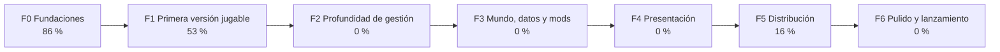

# BM27 — Basketball Manager 2027 (título provisional)

Simulador de gestión de baloncesto para PC: mundo persistente, simulación por posesiones y soporte
de mods. Proyecto **privado y comercial** (ver `LICENSE`). Todos los clubes y jugadores son
ficticios.

> **Estado actual:** ya se puede jugar una partida sencilla: dirigir un equipo, elegir tácticas y
> quinteto, avanzar jornada a jornada y guardar. Los clubes rivales y los cambios durante el
> partido los lleva todavía un entrenador provisional (`PLACEHOLDER`). Hay mercado de agentes libres
> con contratos, topes salariales y finanzas de club, pero todavía no hay traspasos entre clubes.

<!-- roadmap:start -->

## Avance del desarrollo

**Avance orientativo: 35 %** `██████████░░░░░░░░░░░░░░░░░░░░`

295 elementos organizados en 7 fases. Cada elemento pesa lo mismo; el avance en curso es una estimación, no una fecha de entrega.



- **F0 · Fundaciones**: 86 % `█████████████████░░░`
- **F1 · Primera versión jugable**: 53 % `███████████░░░░░░░░░`
- **F2 · Profundidad de gestión**: 0 % `░░░░░░░░░░░░░░░░░░░░`
- **F3 · Mundo, datos y mods**: 0 % `░░░░░░░░░░░░░░░░░░░░`
- **F4 · Presentación**: 0 % `░░░░░░░░░░░░░░░░░░░░`
- **F5 · Distribución**: 16 % `███░░░░░░░░░░░░░░░░░`
- **F6 · Pulido y lanzamiento**: 0 % `░░░░░░░░░░░░░░░░░░░░`

**[Ver el roadmap completo: tareas, responsables y pendientes](docs/roadmap.md)**

<!-- roadmap:end -->

## Qué hay en cada carpeta

| Carpeta           | Qué es                                                                                                                                                                                   |
| ----------------- | ---------------------------------------------------------------------------------------------------------------------------------------------------------------------------------------- |
| `packages/schema` | El **contrato de datos**: qué forma tienen un jugador, un equipo, un reglamento, un partido… Valida los datos al cargarlos y los exporta a JSON Schema (`packages/schema/json-schema/`). |
| `packages/core`   | El **núcleo de simulación**: genera el universo, simula partidos y temporadas, guarda y carga. No tiene interfaz; funciona en Node y en un Web Worker.                                   |
| `apps/web`        | La **página web** mínima. Solo envía órdenes al núcleo (que se ejecuta en un Web Worker) y muestra resultados.                                                                           |
| `tools/cli`       | **Comandos de terminal** para simular y medir rendimiento sin página.                                                                                                                    |
| `docs`            | Documentación: decisiones, estado de las tareas, arquitectura y mediciones.                                                                                                              |
| `.github`         | Automatismos de GitHub: comprobación automática (CI) y plantillas de Pull Request e incidencias.                                                                                         |

## Qué necesitas instalar (una sola vez)

1. **Node.js 22 o superior**: descárgalo de <https://nodejs.org> (botón «LTS») e instálalo.
2. **pnpm**: abre una terminal y escribe:

```bash
npm install -g pnpm
```

3. Descarga las dependencias del proyecto. En la terminal, dentro de la carpeta del proyecto:

```bash
pnpm install
```

## Ver la página

```bash
pnpm web
```

Abre en el navegador la dirección que aparece (normalmente <http://localhost:5173>). Después:

1. Escribe una semilla (cualquier texto) y pulsa **Generar universo**.
2. Elige un equipo en el desplegable y pulsa **Dirigir este equipo**.
3. En las pestañas **Tácticas** y **Quinteto** puedes cambiar cómo juega tu equipo y quién sale de
   titular. Los cambios se aplican desde el siguiente partido.
4. Pulsa **Jugar jornada** para avanzar un partido, o **Simular hasta el final de la temporada**.
5. En **Mercado** puedes fichar agentes libres, renovar contratos y liberar jugadores. Solo entre
   temporadas, respetando el tope salarial y el tamaño de plantilla.
6. En **Finanzas** verás tu caja, tu reputación, tu presupuesto salarial, la previsión de la
   próxima temporada y las cuentas de las temporadas anteriores.
7. En **Mi equipo** verás tu plantilla, tu próximo rival y tu último resultado; **Ver partido**
   abre el box score y la narración jugada a jugada.
8. En **Competición** están las clasificaciones, los playoffs y todos los partidos.
9. Al terminar la temporada, en **Mi equipo** aparece cómo han evolucionado tus jugadores (quién
   mejora, quién baja y quién se retira). La columna **POT** es el potencial de cada uno.
10. **Guardar partida** descarga un archivo; **Cargar partida** lo recupera, también a mitad de
    temporada.

La misma semilla produce siempre el mismo universo. Para cerrar la página, pulsa `Ctrl + C` en la
terminal.

## Instalar el juego en Windows (.exe)

Hay un instalador para Windows en la pestaña **Releases** del repositorio (con tu sesión de GitHub
abierta). Descarga el `.exe`, ejecútalo y, si Windows avisa de que no reconoce al editor, pulsa
**«Más información»** y **«Ejecutar de todos modos»**. Detalles y límites en
[`docs/escritorio.md`](docs/escritorio.md).

## Ejecutar los tests

```bash
pnpm test
```

Deben salir todos en verde (tarda en torno a medio minuto). Otras comprobaciones, las mismas que hace
GitHub automáticamente en cada Pull Request:

```bash
pnpm lint
```

```bash
pnpm format:check
```

```bash
pnpm typecheck
```

## Simular desde la terminal

Simula 3 temporadas con la semilla `demo` y exporta el guardado a un archivo:

```bash
pnpm sim --seed demo --seasons 3 --out saves/demo.json
```

## Medir el rendimiento (benchmarks)

```bash
pnpm bench
```

Ejecuta las pruebas B1–B4 (tarda en torno a un minuto) y escribe el resultado en
[`docs/benchmarks/T-006.md`](docs/benchmarks/T-006.md).

## Comprobar la calibración del motor

```bash
pnpm calibrate
```

Simula la liga regular de cada nivel y compara las medias (puntos, posesiones, porcentajes,
faltas…) con bandas de referencia. Con `pnpm calibrate --write` guarda el informe en
[`docs/benchmarks/T-006-calibracion.md`](docs/benchmarks/T-006-calibracion.md).

## Comprobar que el mundo es estable a largo plazo

```bash
pnpm stability
```

Simula 30 temporadas seguidas y muestra cómo evolucionan el nivel de cada liga, la edad media y las
retiradas. Con `pnpm stability --write` guarda el informe en
[`docs/benchmarks/T-006-estabilidad.md`](docs/benchmarks/T-006-estabilidad.md). Tarda en torno a
un minuto y medio.

## Otros comandos

| Comando              | Para qué                                                             |
| -------------------- | -------------------------------------------------------------------- |
| `pnpm format`        | Ordena el formato del código automáticamente.                        |
| `pnpm build`         | Compila la página web para comprobar que no hay errores.             |
| `pnpm schema:export` | Regenera los archivos JSON Schema tras cambiar el contrato de datos. |

## Cómo se trabaja

Las reglas del proyecto están en [`CLAUDE.md`](CLAUDE.md) y el estado de las tareas en
[`docs/estado.md`](docs/estado.md). Cada tarea va en su propia rama y entra mediante Pull Request;
nunca se sube nada directamente a `main`.
