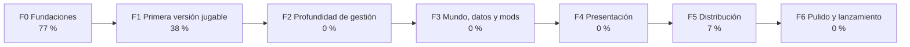

# BM27 · Basketball Manager 2027

  

<strong>Una carrera en el banquillo. Un proyecto de club. Un mundo que sigue jugando.</strong>

  <a href="#qué-puedes-jugar-hoy">El juego hoy</a> ·
  <a href="#avance-del-desarrollo">Avance</a> ·
  <a href="docs/roadmap.md">Roadmap completo</a> ·
  <a href="#cómo-probar-bm27">Cómo probarlo</a> ·
  <a href="docs/desarrollo.md">Desarrollo</a>

BM27 es un **simulador de gestión de baloncesto para PC**: eliges un equipo, decides cómo juega y
construyes su futuro temporada a temporada. Clubes y jugadores ficticios en un mundo persistente.
El objetivo es que cada decisión tenga consecuencias que puedas entender.

> **En desarrollo · Prototipo jugable.** Basketball Manager 2027 es un nombre provisional.
> Este repositorio es privado y comercial; consulta la [licencia](LICENSE).
> La ilustración de portada representa la identidad del proyecto, no una pantalla disponible del juego.

## Qué puedes jugar hoy

| En el banquillo                                                     | En el despacho                                                           | A lo largo de los años                                                |
| ------------------------------------------------------------------- | ------------------------------------------------------------------------ | --------------------------------------------------------------------- |
| Elige equipo, quinteto y tácticas.                                  | Ficha agentes libres, renueva y libera jugadores.                        | Avanza jornadas y temporadas en una pirámide de cuatro niveles.       |
| Consulta el resultado, las estadísticas y la narración del partido. | Gestiona contratos con topes salariales y consulta las cuentas del club. | Sigue la evolución, el envejecimiento y la retirada de los jugadores. |
| Tus ajustes afectan a los partidos futuros.                         | Revisa caja, reputación y presupuesto salarial.                          | Guarda y recupera tu partida, también a mitad de temporada.           |

**Una misma semilla, un mismo universo.** El azar del motor es reproducible. Las estadísticas se
calculan desde lo ocurrido en la simulación, y los detalles de partido que no pueden verificarse se
identifican como no disponibles.

### Hacia dónde va el juego

La profundidad se desarrollará por fases: negociación de traspasos, entrenamientos, lesiones,
vestuario, cantera, ojeo y entrenadores rivales con criterio. Son **trabajo pendiente**, no funciones
que se anuncien como disponibles. El entrenador actual y la generación de jóvenes son provisionales
(`PLACEHOLDER`). Las escalas económicas y las bandas de calibración aún usan aproximaciones.

<!-- roadmap:start -->

## Avance del desarrollo

**Avance orientativo: 22 %** `██████░░░░░░░░░░░░░░░░░░░░░░░░`

475 elementos organizados en 7 fases y 34 áreas de desarrollo. Cada elemento pesa lo mismo; el avance en curso es una estimación, no una fecha de entrega.

- **F0 · Fundaciones**: 77 % `███████████████░░░░░`
- **F1 · Primera versión jugable**: 38 % `████████░░░░░░░░░░░░`
- **F2 · Profundidad de gestión**: 0 % `░░░░░░░░░░░░░░░░░░░░`
- **F3 · Mundo, datos y mods**: 0 % `░░░░░░░░░░░░░░░░░░░░`
- **F4 · Presentación**: 0 % `░░░░░░░░░░░░░░░░░░░░`
- **F5 · Distribución**: 7 % `█░░░░░░░░░░░░░░░░░░░`
- **F6 · Pulido y lanzamiento**: 0 % `░░░░░░░░░░░░░░░░░░░░`

**[Ver el roadmap completo: tareas, responsables y pendientes](docs/roadmap.md)**

<!-- roadmap:end -->

## Cómo probar BM27

### Quiero jugar en Windows

El instalador se ha compilado en Windows mediante GitHub Actions. **Todavía no hay una Release
publicada en este repositorio**: la vía actual es descargar una compilación de prueba desde los
artefactos de Actions, con acceso al repositorio.

**[Abrir la guía de instalación y descarga de prueba →](docs/escritorio.md#probar-sin-esperar-a-una-versión-publicada)**

La instalación y los diálogos de guardado aún necesitan comprobarse en un Windows real. La guía
explica qué se ha validado, los requisitos y el estado de las actualizaciones automáticas.

### Quiero ejecutarlo o colaborar en el código

Necesitas Node.js 22 o superior y pnpm. La [guía de desarrollo](docs/desarrollo.md) reúne la
instalación, los comandos para arrancar la web, las pruebas y las herramientas de simulación.

## Qué guía el proyecto

- **Simulación con consecuencias.** Las tácticas y decisiones tienen efecto en el motor; lo provisional se identifica.
- **Un mundo propio.** El contenido del juego utiliza identidades ficticias.
- **Una partida explicable.** Resultados y estadísticas parten del mismo registro de eventos.
- **Un plan visible.** El desarrollo sigue el roadmap, dentro del trabajo que autorice el propietario.

## Explorar BM27

| Quiero entender…                               | Ir a…                                        |
| ---------------------------------------------- | -------------------------------------------- |
| Todo lo previsto, por fases, áreas y subcampos | [Roadmap detallado](docs/roadmap.md)         |
| Qué se ha entregado y qué está pendiente       | [Estado de las tareas](docs/estado.md)       |
| Por qué se tomó cada decisión                  | [Registro de decisiones](docs/decisiones.md) |
| Cómo funciona el motor y la aplicación         | [Arquitectura](docs/arquitectura.md)         |
| Qué cambia cada táctica                        | [Tácticas](docs/tacticas.md)                 |
| Cómo instalar, ejecutar y comprobar el código  | [Guía de desarrollo](docs/desarrollo.md)     |
| Cómo se organiza el trabajo                    | [Coordinación](docs/coordinacion.md)         |
| El resto de la documentación                   | [Índice de documentación](docs/README.md)    |

---

**BM27 está construyéndose.** La portada muestra el estado actual; el roadmap describe el alcance
previsto. Una tarea pendiente no es una promesa de fecha ni una función ya implementada.
