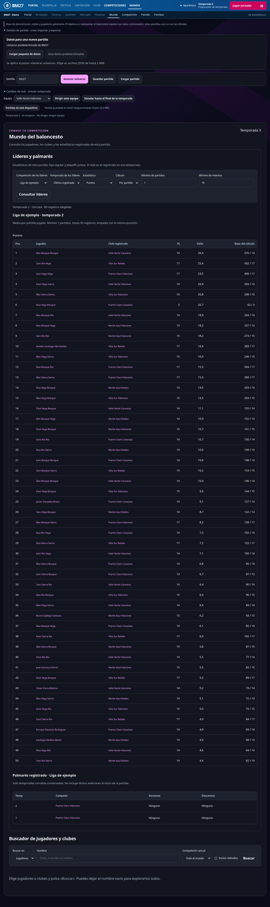

# Consultar el mundo de la partida — #67 y #72

La sección **Mundo** de la cabecera permite buscar jugadores y clubes. Funciona en PC, con temas
claro y oscuro. No cambia las tácticas, fichajes ni resultados del universo.

## Buscar y navegar

1. Elige jugadores o clubes. Deja el nombre vacío para explorarlos todos o escribe parte del nombre.
2. Puedes filtrar por competición actual. Los jugadores libres y retirados no tienen competición actual.
3. Pulsa «Buscar». Las búsquedas no distinguen mayúsculas ni tildes y devuelven páginas de 40 resultados.
4. Pulsa un nombre para abrir su ficha. Desde la plantilla de un club se abre cualquier jugador;
   desde un jugador con club se abre ese club. «Volver a la consulta anterior» conserva el recorrido.

Las consultas se hacen en el Worker propietario de la partida. Los filtros o IDs incorrectos devuelven
un error sin descartar el universo ni modificar el guardado. Al avanzar la simulación se reinicia la
consulta visible, para evitar presentar una ficha antigua como actual.

## Ficha de jugador

Muestra edad, altura, posiciones, contrato anual, lesión del juego y sus veinte atributos agrupados.
El potencial exacto solo se envía cuando el jugador pertenece al equipo que diriges; para rivales,
libres y una partida sin entrenador, el Worker envía `null`, no un número oculto por CSS.

Las estadísticas por temporada proceden de los registros conservados: minutos, puntos, rebotes y
asistencias por partido. Mantienen el club de aquella temporada, aunque el jugador ahora esté en
otro equipo o retirado. No se inventa una trayectoria anterior al inicio de la partida. Si no hay
partidos registrados, la ficha lo indica.

Los atributos actuales de la demo son datos de simulación; el sistema de ojeo con incertidumbre
sigue pendiente. No se presentan como valoraciones oficiales de personas reales.

## Ficha de club

Incluye ubicación, competición, reputación, tope salarial de la liga, tácticas, plantilla enlazada y los
diez últimos resultados conservados, con temporada, ronda, local/visitante y marcador del club.
No envía la caja privada de clubes rivales.

[Jugador, PC 1280 × 800, oscuro](screenshots/world-player-desktop-dark.png) ·
[Club, PC 1920 × 1080, claro](screenshots/world-club-wide-light.png).

## Verificación

- `apps/web/test/worldData.test.ts`: seis pruebas de paginación completa, búsquedas/filtros,
  información oculta, estadísticas históricas, plantilla/resultados y consultas sin mutaciones.
- `apps/web/test/worldWorker.test.ts`: ruta real de comandos/respuestas, potencial rival excluido,
  recuperación tras error y JSON de guardado idéntico antes/después de consultar.
- `python tools/qa/world_browser.py`: 16 combinaciones de búsqueda, club, jugador rival y propio,
  en 1280 × 800 y 1920 × 1080, claro/oscuro. Paginación sin duplicados, enlaces, retorno, foco de la
  ficha y búsqueda sin resultados comprobados; 0 incidencias de axe y 0 errores JavaScript.
- `BM27_SCREENSHOT_DIR=/tmp/bm27-67-regression-shots python tools/qa/demo_visual.py`: otras
  52 comprobaciones del armazón y pantallas existentes, sin incidencias ni desbordamiento global.

Las herramientas externas de navegador son las documentadas en la [revisión del portal](revisiones/portal-52.md).
No se añaden dependencias al juego. La comprobación automática no equivale a una certificación de
accesibilidad ni a una prueba del instalador Windows.

## Qué sigue pendiente

Las entregas #67 y #72 cubren buscador, fichas, líderes y palmarés de #14. Quedan trayectoria más
detallada y entrada directa desde la clasificación. Los cinco paneles reservados por Claude no se han modificado.
Los datos siguen siendo los de la demo generada; el catálogo español de #61 aún no se carga en la partida.

Validación de la primera entrega (#67): **265/265 pruebas** (`pnpm test --maxWorkers=2`), lint, formato,
TypeScript, compilación y `roadmap:check` correctos. Las 16 comprobaciones específicas y las
52 de regresión del navegador se ejecutaron con las funciones reales del juego.

## Líderes y palmarés (#72)

En **Mundo**, el bloque **Líderes y palmarés** permite elegir competición, temporada, estadística y
cálculo por partido o total. Pulsa **Consultar líderes** después de cambiar los filtros. «Última
registrada» elige la temporada en curso si existe; entre temporadas elige la última cerrada.

Puntos, rebotes (ofensivos + defensivos), asistencias, robos y tapones proceden de los acumulados
del guardado. Las medias dividen por partidos jugados. Los porcentajes de campo, triples y tiros
libres usan sus propios aciertos e intentos; no son una media de porcentajes de partidos. La tabla
muestra también el numerador y denominador, para poder comprobar cada cifra.

Los mínimos de partidos e intentos son filtros del usuario, **no criterios oficiales de elegibilidad**.
El mínimo de intentos solo se aplica a porcentajes. Nunca se divide entre cero ni se incluyen
jugadores sin partidos. Se muestran hasta 50 registros ordenados por valor sin redondear; los
empates exactos comparten posición. Cada fila conserva el club de sus estadísticas, aunque el
jugador tenga otro club o esté retirado. Si hay dos jugadores con el mismo nombre, sus fichas
siguen enlazadas por ID independiente. El historial actual agrega liga regular y playoffs, sin un
filtro por fase que el guardado no conserva por separado.

El palmarés reúne campeones, ascensos y descensos de las temporadas **cerradas** de esa competición.
No añade títulos anteriores al inicio de la partida ni declara campeón al líder provisional. Los
nombres de jugadores y clubes abren sus fichas. Las consultas no alteran el universo ni consumen RNG.

Verificación adicional: seis pruebas de datos y extensión del test del Worker real; recorrido de
navegador `tools/qa/league_records_browser.py` sobre un guardado creado simulando dos temporadas:
medias/totales/porcentajes, muestras, enlaces, exportación idéntica tras consultar y tercera temporada
sin campeón inventado. La herramienta necesita Playwright, Chromium, axe y el guardado de prueba:

```bash
pnpm sim --pack data/packs/example-eight-clubs.json --seed league-browser --seasons 2 --out /tmp/bm27-league-save.json
python tools/qa/league_records_browser.py
```



Validación de #72: **280/280 pruebas** de la suite completa, lint, tipos, formato y compilación correctos. Las diez comprobaciones específicas y las dieciséis de regresión del buscador/fichas pasaron sin errores JavaScript, desbordamiento global ni infracciones axe detectadas.
