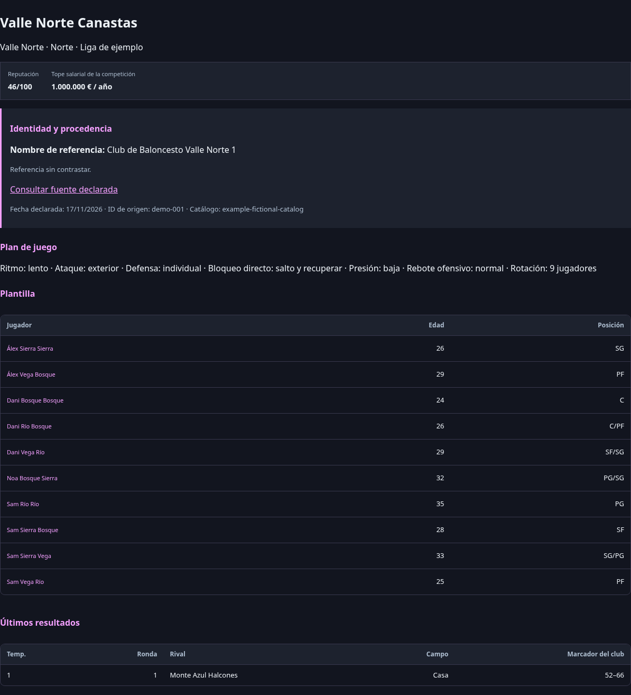

# Clubes definidos y procedencia en paquetes — #79

Un paquete puede definir cada club individualmente, con un identificador estable, nombre visible,
ubicación, competición inicial y referencia de origen. Los jugadores siguen siendo generados.
Esto prepara la carga de un catálogo como el español, pero **no incorpora la semilla española a
la partida ni certifica sus participantes o reglamentos**.

## Probar el ejemplo

Carga [example-eight-defined-clubs.json](../../data/packs/example-eight-defined-clubs.json) desde
**Configurar nueva partida → Cargar paquete de datos** y pulsa **Nueva partida**. Contiene ocho clubes
**ficticios** con plantillas generadas, usando el mismo reglamento de demostración de dos periodos
de quince minutos. También se puede simular desde la raíz:

```bash
pnpm sim --pack data/packs/example-eight-defined-clubs.json --seed clubes --seasons 2 --out saves/clubes.json
```

En **Mundo**, busca un club y abre su ficha. El bloque **Identidad y procedencia** separa su nombre
de referencia del nombre visible y muestra las referencias que haya declarado el autor del paquete.
El menú de opciones distingue clubes generados de clubes definidos; no presenta estos últimos como una
base oficial. La selección de un paquete prepara la siguiente partida y no cambia la que está abierta.

El ejemplo incluye una referencia sin contrastar a su propio archivo del repositorio; no se hace
pasar por una fuente de una competición real. Los demás clubes no declaran fuente externa.

## Datos del formato

El campo opcional `clubs` se añade a los campos de [paquetes](paquetes.md). Si se proporciona,
debe cubrir **todos los clubes** del universo, con exactamente el número definido en cada competición.
No se mezclan clubes explícitos y generados dentro de este primer formato de carga.

| Campo de cada club       | Significado                                                                                                                   |
| ------------------------ | ----------------------------------------------------------------------------------------------------------------------------- |
| `id`                     | Identificador estable: letras/cifras, punto, guion, guion bajo o dos puntos; hasta 160 caracteres. Empieza por letra o cifra. |
| `name`                   | Nombre visible o alias; puede cambiar sin cambiar el ID.                                                                      |
| `city`, `region`         | Ubicación y región declaradas por el paquete. La región debe existir en `config.regions`.                                     |
| `competitionId`          | Competición inicial, existente en `config.levels`.                                                                            |
| `identity.referenceName` | Nombre de referencia, independiente del alias. No implica razón social ni identidad oficial.                                  |
| `identity.source`        | `null` si no hay fuente externa, o el objeto de procedencia descrito debajo.                                                  |

La fuente contiene `catalogId`, `clubId` (identidad dentro de ese catálogo), `url` HTTP(S) sin
credenciales, `capturedOn` en formato de fecha `AAAA-MM-DD` y `verification`. Se comprueban estructura,
fecha válida, URL y duplicados; el cargador no consulta esas páginas ni verifica hechos o condiciones
de uso.

`verification` admite `unverified` y `declared-verified`. La segunda opción significa **verificación
declarada por el autor**, no verificación realizada por BM27. La interfaz explica ambas situaciones.
Un alias o una referencia no acreditan derechos de uso sobre datos, marcas, escudos o fotografías.
El [JSON Schema](../../packages/schema/json-schema/club-definition.schema.json) y el ejemplo completo
son las referencias técnicas; las relaciones entre registros se comprueban también en ejecución.

## Identidad y determinismo

Las definiciones se emparejan con las plazas de cada competición ordenando por ID, nunca por nombre
ni por posición en el archivo. Los IDs finales se aplican también a los jugadores y miembros de las
competiciones antes de iniciar la partida. Así, reordenar `clubs` o cambiar solo `name` no altera
plantillas, estadísticas o resultados para la misma semilla. La ciudad y la región sí intervienen en
la formación geográfica de grupos; cambiarlas es un cambio deportivo de los datos.

Los IDs se conservan al guardar/cargar, al cambiar de temporada y tras ascensos o descensos. La
estabilidad depende de que el autor conserve el mismo ID para la misma identidad. No se concilian
automáticamente entidades de dos catálogos o temporadas de investigación distintos. Una URL o un
nombre coincidente tampoco prueban que dos clubes sean la misma entidad.

`names` sigue siendo obligatorio y debe superar las validaciones del generador de base, incluida la
cantidad suficiente de nombres de club. Esta entrega aplica después las identidades explícitas sin
cambiar el consumo de azar del generador. No es un importador de plantillas individualizadas ni de
valoraciones deportivas; estas y la economía siguen siendo **PLACEHOLDER** del modelo actual.

## Guardados y compatibilidad

El contrato sube a **8**. Cada club guarda `identity`, con el nombre original y las declaraciones de
fuente, o `null` para las identidades generadas. La migración 7→8 añade `null` a los guardados previos
sin inventarles una procedencia. Las migraciones anteriores siguen encadenándose.

El formato de paquete sigue siendo **1**. El cargador admite paquetes del contrato 7 que no tengan
el campo `clubs`: los normaliza a 8 antes de validar. Un paquete que declare 7 y utilice `clubs` se
rechaza, igual que una versión futura desconocida. El JSON Schema describe el contrato actual;
la compatibilidad de entrada anterior la realiza `parseDataPack`.

Una partida guardada conserva estas identidades y no necesita volver a leer el archivo original.
La serialización puede normalizar el orden de claves al importarla, pero los datos deben ser iguales;
no se promete que el texto de dos exportaciones separadas por una importación sea byte a byte igual.

## Qué sigue faltando para España

La semilla de 202 clubes permanece en investigación. Faltan contraste de participantes/reglas,
condiciones de uso, ubicaciones con procedencia y los subgrupos de calendario desconocidos de
Tercera FEB. Esta entrega **no importa grupos explícitos**: se mantiene el agrupamiento geográfico
genérico. No deben transformarse las conferencias P3 en cinco ligas ni inventarse diez subgrupos.
Las consultas HTTPS a ACB y FEB se volvieron a intentar en esta tarea y el entorno devolvió
`CONNECT 403`; no se declara una consulta oficial completada.

## Verificación

- Ocho pruebas nuevas del núcleo: dos temporadas y guardados con identidades, cambios de alias y
  orden sin alterar datos deportivos, ascensos/descensos, errores de campo, fuentes/fechas,
  compatibilidad de paquetes v7, importación de guardado v7 con checksum e independencia del objeto
  de entrada.
- Prueba del Worker real: selección, generación, equipo dirigido por ID externo, ficha, error sin
  alterar partida/selección, recarga y retorno a datos generados.
- Comparación contra archivos producidos **antes de editar** (`club-identity-compat`): generación y
  una temporada predeterminadas idénticas tras normalizar solo la versión y `identity: null`.
  No cambia el motor ni la economía, y no se atribuye una recalibración a esta entrega.
- `tools/qa/club_identity_browser.py`: datos y referencias visibles, partido real con los nuevos IDs,
  archivos de guardado, cambio de alias y paquete antiguo. Solo PC, temas claro/oscuro.



Validación final de #79: **295/295 pruebas**, lint, tipos, formato, compilación, esquemas JSON y `roadmap:check` correctos. Las 16 comprobaciones específicas de navegador y otras 16 de regresión del buscador/fichas pasaron sin errores JavaScript, desbordamientos globales ni infracciones axe detectadas. Sin prueba nativa en Windows real.
