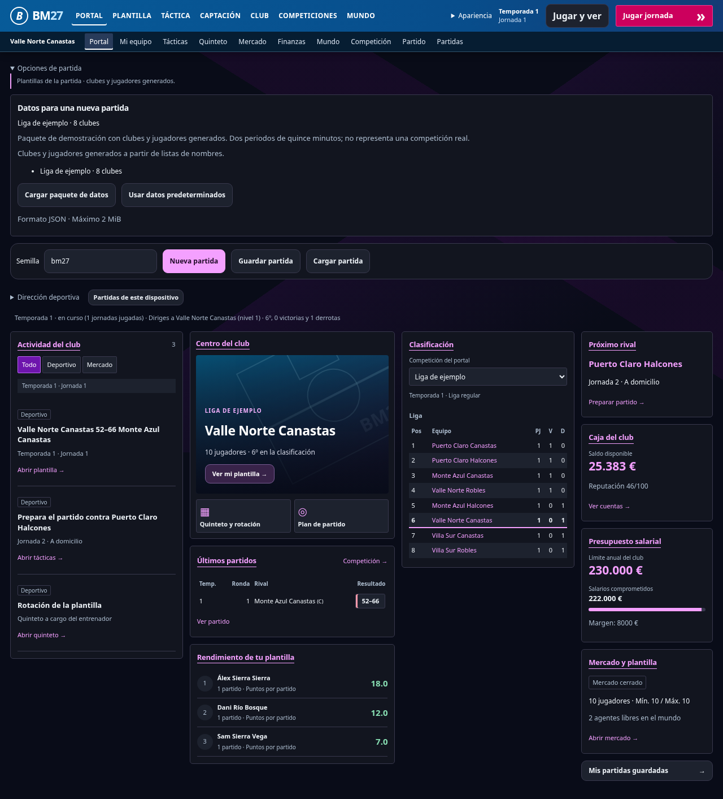

# Paquetes de datos para nuevas partidas

BM27 puede crear una partida a partir de un archivo JSON con competiciones, reglamentos,
economía y listas de nombres. No hace falta modificar el motor. El paquete de ejemplo es una
**demostración generada**, no una competición oficial ni una base de jugadores reales.

## Probarlo en PC

1. Descarga [el ejemplo de ocho clubes](../../data/packs/example-eight-clubs.json).
2. Abre **Gestión de partida** y pulsa **Cargar paquete de datos**.
3. Selecciona el archivo. BM27 valida su contenido y muestra sus competiciones.
4. Pulsa **Generar universo**. Si ya hay una partida abierta, confirma su sustitución después de
   guardar los cambios que quieras conservar.

Seleccionar o quitar un paquete no cambia la partida actual. **Usar datos predeterminados** prepara
la siguiente generación con los datos incluidos en BM27. La selección no se conserva al cerrar la
aplicación; una partida guardada sí conserva las competiciones, reglas, nombres y el identificador
del paquete que necesita para seguir jugando, sin volver a cargar el archivo original.

En la aplicación de escritorio se utiliza el selector nativo de archivos ya existente. Su ejecución
en Windows real queda pendiente; se ha probado el recorrido completo en Chromium para PC.

## Línea de comandos

Desde la raíz del repositorio:

```bash
pnpm sim --pack data/packs/example-eight-clubs.json --seed demo --seasons 1 --out saves/ejemplo.json
```

Sin `--pack` se mantiene el universo predeterminado. Una ruta relativa se interpreta desde el
directorio donde se escribió el comando. Un paquete inválido devuelve un error y código de salida 1.

## Formato 1

El archivo completo de ejemplo es la referencia mínima editable. Todos estos campos pertenecen a
un único objeto JSON:

| Campo                 | Contenido                                                                                                           |
| --------------------- | ------------------------------------------------------------------------------------------------------------------- |
| `formatVersion`       | `1`, versión del formato de paquete.                                                                                |
| `schemaVersion`       | `8`, versión actual del contrato.                                                                                   |
| `id`                  | Identificador estable del paquete: letras minúsculas, cifras, punto, guion o guion bajo; empieza por letra o cifra. |
| `name`, `description` | Nombre visible y explicación de la procedencia o limitaciones. Descripción opcional.                                |
| `config`              | Regiones, niveles, número de clubes, formato de competición, plantilla y parámetros económicos.                     |
| `rulesets`            | Reglamentos identificados por `id`; cada nivel indica el suyo en `rulesetId`.                                       |
| `names`               | Ciudades con región, apodos, nombres y apellidos que usa el generador.                                              |

El [JSON Schema del paquete](../../packages/schema/json-schema/data-pack.schema.json) describe
los campos y límites estructurales. La validación en ejecución comprueba además relaciones que
JSON Schema no expresa: referencias existentes, niveles consecutivos, equilibrio de ascensos y
descensos, nombres suficientes y no ambiguos, regiones declaradas, plazas de playoffs y capacidad
salarial para la plantilla mínima. Los mensajes identifican el campo y el motivo.

El ejemplo tiene ocho clubes, una liga a doble vuelta y playoffs de cuatro clasificados. Su
reglamento usa **dos periodos de quince minutos**, reloj de posesión de veinte segundos y cuatro
faltas personales: sirve para demostrar que el motor consume las reglas del archivo, no para
representar una competición española. Son 56 partidos de liga regular y una cifra variable en los
playoffs, según la duración de sus series. Las cifras económicas y la generación de jugadores son
**PLACEHOLDER** del modelo actual; no constituyen una calibración de una liga real.

Límites actuales: JSON UTF-8 de hasta 2 MiB, hasta 512 clubes en total, 12 niveles, 32 reglamentos y
plantillas de entre 5 y 30 jugadores. No se admiten scripts, archivos comprimidos ni recursos
externos ejecutables. El núcleo recibe texto o datos ya leídos; no accede a red, disco ni navegador.

## Clubes definidos individualmente

El campo opcional `clubs` permite fijar identidades, nombres visibles, ubicación y referencias para
todos los clubes. Ver [formato, ejemplo y límites de identidades](identidades-clubes.md). Sin ese
campo, se conservan las identidades generadas a partir de `names`. Los jugadores siguen generándose.

## Guardados y compatibilidad

El contrato de partida sube de 6 a 7 para conservar `namePool` y `dataPackId`. La migración de un
guardado anterior añade ambos campos con valor `null`: mantiene el generador de nombres habitual.
Los guardados nuevos de paquetes conservan sus listas también durante el reemplazo provisional de
jugadores retirados por jóvenes. No equivalen a una cantera modelada.

El contrato actual es 8: añade `Team.identity` nullable y una migración 7→8 que no inventa fuentes
para clubes anteriores. Un guardado nuevo no puede abrirse con una aplicación antigua que desconozca
su versión.

El formato de paquete sigue en 1. Los paquetes de contrato 7 **sin `clubs`** son compatibles y se
normalizan a 8 antes de validar. Los de versiones desconocidas, o que usan campos nuevos declarando
una versión antigua, se rechazan. No hay un migrador general de paquetes; las migraciones de partidas
son un mecanismo distinto.

## Qué falta para la base española

El formato admite clubes definidos individualmente y sus referencias declaradas, pero todavía
**no importa jugadores individualizados ni asignaciones explícitas a subgrupos de calendario**.
El [catálogo de la semilla española](catalogo-semilla.md) sigue separado y pendiente de contraste.
En particular, las cinco conferencias de Tercera FEB no se convierten en cinco ligas ni en diez
subgrupos inventados. La infraestructura de identidad no equivale a tener integrada una temporada
española oficial.

## Verificación de esta entrega (#21)

- Pruebas del núcleo: temporada completa con el ejemplo, determinismo, nombres tras retiradas y
  guardado, migración de versión 6 y errores de campos, versiones, tamaño y relaciones.
- Prueba con el Worker real: selección, rechazo de archivo inválido sin perder la selección ni la
  partida, generación de ocho clubes y retorno al universo predeterminado.
- `tools/qa/data_pack_browser.py`: diez comprobaciones PC en 1280×800 y 1920×1080, temas claro y
  oscuro, Portal y Partido; selección, errores, reglas, exportación/recarga, cancelación y límites.
  Sin desbordamiento ni infracciones detectadas por axe en las reglas WCAG A/AA comprobadas.
- Comparación local con el estado anterior, semilla `pack-default-compat`: generación y temporada
  predeterminadas conservan exactamente los datos deportivos; solo se añaden la versión y los dos
  campos de información del paquete. Por ello no se atribuye a esta entrega una recalibración del
  motor o de la economía predeterminada.


