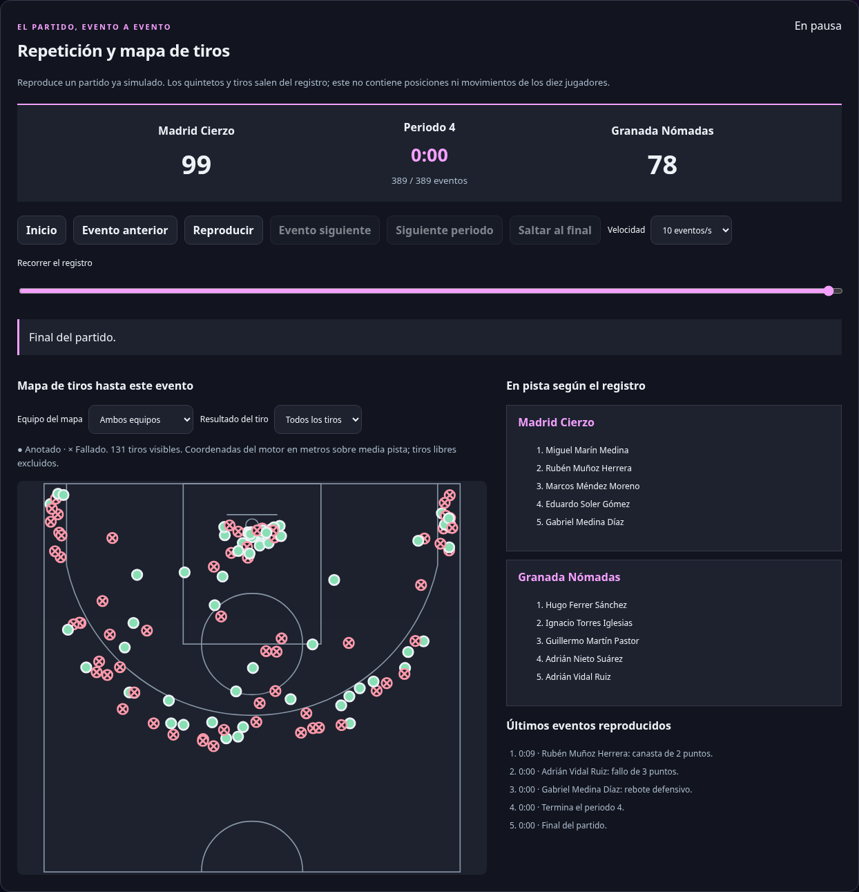
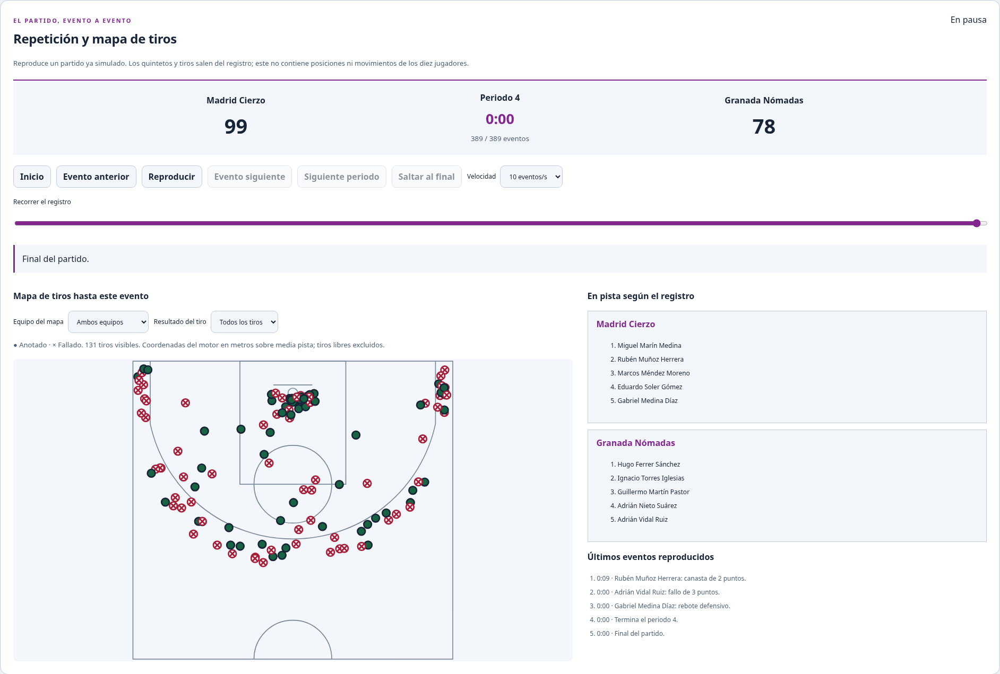

# Repetición del partido y mapa de tiros — primera entrega de #15

Después de jugar una jornada, pulsa **Ver partido**. También puedes abrir un partido desde
**Competición**. La pestaña **Partido** muestra ahora un reproductor del registro, además del acta
y la narración que ya existían. Es una repetición de un partido calculado, no un partido que se
esté simulando en directo.

## Cómo se usa en PC

- **Reproducir / Pausar:** recorre los eventos. La velocidad se expresa en eventos por segundo,
  no en minutos reales del partido. Al llegar al final se detiene.
- **Evento anterior / siguiente:** avanza una sola anotación del registro.
- **Siguiente periodo:** salta al inicio del siguiente periodo registrado, incluidas prórrogas.
- **Inicio / Saltar al final:** vuelve al comienzo o muestra el resultado completo.
- **Recorrer el registro:** permite desplazarse con ratón o teclado; Inicio/Fin y flechas funcionan
  con el control enfocado. Desplazarse manualmente pausa la reproducción.

El reloj muestra los segundos que quedaban en el periodo al registrarse el evento. No se inventan
segundos intermedios. El marcador se reconstruye sumando canastas y tiros libres; estos últimos se
atribuyen al club del tirador, también en una técnica cuando el derecho al balón es del otro equipo.
El resultado final se comprueba contra el box score. Si no coincide, aparece un error y no se inicia
la reproducción automática.

Los quintetos de ambos clubes proceden de los eventos de alineación y sustitución. Antes de que
aparezca su evento inicial, el panel indica que aún no están registrados. Se muestran en listas:
el registro no proporciona la posición o trayectoria de los diez jugadores sobre la pista.

## Mapa de tiros

Muestra únicamente los tiros de campo ocurridos hasta el evento seleccionado. Los tiros libres
están en el marcador y la narración, pero no se dibujan como tiros de campo.

- Cada punto conserva exactamente las coordenadas `x`, `y` del motor, en metros de media pista.
- Ambos clubes se representan en la misma media pista normalizada; no es un mapa de movimientos.
- El punto lleno representa un acierto y la cruz un fallo; no depende solo del color.
- Puedes filtrar por club y por acierto/fallo. El contador refleja los tiros visibles con esos filtros.
- Pulsa un punto, o enfócalo y usa Intro/Espacio, para volver al evento de ese tiro.

Las coordenadas pertenecen a la simulación provisional del motor, no a mediciones de partidos reales.
La reproducción no cambia tácticas, jugadores, resultados ni guardados, y no utiliza azar. Al salir de
la pantalla se detiene su temporizador; volver abre la repetición pausada desde el comienzo.

## Límites y siguiente entrega

Esta entrega no cierra #15. Siguen pendientes la presentación al avanzar una jornada en modo
«directo», las estadísticas completas durante la reproducción y las posiciones de los jugadores.
No se dibujan trayectorias ficticias para dar por terminado el visualizador posicional 2D. El motor
sigue teniendo sus decisiones de entrenador y otros componentes marcados como PLACEHOLDER.

No cambia el contrato, la API pública, el motor ni el formato de guardado. La verificación de
repeticiones del Worker sigue siendo la misma: una visualización solo recibe detalles que ha podido
reconstruir con las entradas conservadas de ese partido.

## Comprobaciones reales

- `apps/web/test/replay.test.ts`: seis pruebas sobre una competición completa de ocho clubes:
  resultado de cada partido contra su acta, reloj/eventos, coordenadas, quintetos y sustituciones,
  conservación de las instantáneas previas, atribución de tiros libres técnicos, jugador ajeno al acta
  rechazado y descripciones de los eventos encontrados. Las consultas dejan el registro intacto.
- `python tools/qa/replay_browser.py`: diez comprobaciones en PC (1280×800 y 1920×1080, temas claro
  y oscuro), con un partido real del motor: pausa, velocidad, periodos, marcador, cada coordenada del
  mapa, filtros, teclado, salida/retorno y exportación de partida idéntica tras reproducir.
- Las capturas de abajo son del componente real en esas resoluciones, sin la narración y tablas que
  siguen debajo. No se ha ejecutado la aplicación nativa en un Windows real.

Validación de la entrega: **286/286 pruebas** de la suite completa; lint, tipos, formato,
compilación y `roadmap:check` correctos. Las diez comprobaciones específicas y otras 52 del armazón
pasaron sin errores de navegador, desbordamiento global ni infracciones axe detectadas. El reproductor
recibe el foco al abrirse y queda por debajo de la cabecera fija; esto se comprobó también en el
recorrido específico final.
