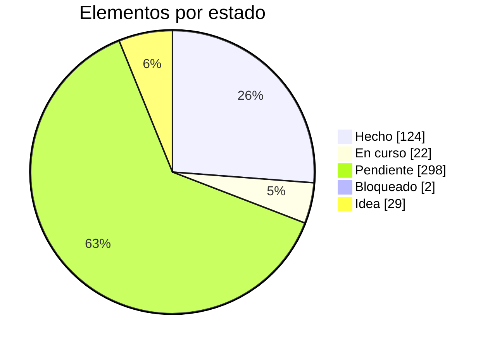

<!-- Generado por tools/roadmap/roadmap.mjs desde docs/roadmap/roadmap.json. NO editar a mano. -->

# Hoja de ruta de BM27

> Actualizada: 2026-11-17. Se genera con `pnpm roadmap` a partir de [`roadmap/roadmap.json`](roadmap/roadmap.json); la CI falla si este archivo no coincide con los datos.
>
> **Cómo leer los porcentajes.** El índice de preparación pondera las fases por su importancia para el producto completo. La cobertura interna de cada fase cuenta sus tareas por igual: es un inventario, no una medición de calidad o esfuerzo. Los pesos son decisiones de planificación publicadas, no datos de un competidor. El 100 % exige además validar todos los criterios de lanzamiento con evidencia. «En curso» sigue siendo una estimación; ideas y bloqueos valen cero.

## Resumen

**Preparación estimada para lanzamiento: 17 %** `█████░░░░░░░░░░░░░░░░░░░░░░░░░`  (475 elementos)

## Objetivo del 100 %

Gestor de baloncesto comercial completo, con la profundidad de gestión como referencia de diseño. No es una medición de equivalencia con Football Manager.

| Fase | Peso en el producto |
| --- | ---: |
| F0 Fundaciones | 5 % |
| F1 Primera versión jugable | 10 % |
| F2 Profundidad de gestión | 40 % |
| F3 Mundo, datos y mods | 15 % |
| F4 Presentación | 15 % |
| F5 Distribución | 5 % |
| F6 Pulido y lanzamiento | 10 % |

**Criterios de salida** (todos deben estar validados para declarar un lanzamiento completo):

- ⬜ **R1** Ciclo de gestión completo: fichajes entre clubes, plantilla, entrenamiento, salud y cantera
- ⬜ **R2** Entrenadores rivales y decisiones con profundidad, sin sustitutos provisionales esenciales
- ⬜ **R3** Mundo equilibrado a largo plazo y reglas de competición contrastadas
- ⬜ **R4** Interfaz accesible, ayuda y recorrido de varias temporadas validado con jugadores
- ⬜ **R5** Guardados internos, recuperación y migraciones probados
- ⬜ **R6** Instalación, actualizaciones y compatibilidad verificadas en los sistemas soportados
- ⬜ **R7** Equilibrio, rendimiento, licencias y criterios de lanzamiento cerrados

La cobertura del inventario es 28 %; no debe confundirse con preparación comercial.

## Fases (del punto A al Z)

```mermaid
flowchart LR
  F0["F0 Fundaciones<br/>76 %"]
  F1["F1 Primera versión jugable<br/>59 %"]
  F2["F2 Profundidad de gestión<br/>3 %"]
  F3["F3 Mundo, datos y mods<br/>9 %"]
  F4["F4 Presentación<br/>22 %"]
  F5["F5 Distribución<br/>19 %"]
  F6["F6 Pulido y lanzamiento<br/>6 %"]
  F0 --> F1 --> F2 --> F3 --> F4 --> F5 --> F6
  classDef hecho fill:#2da44e,color:#fff,stroke:#1a7f37;
  classDef curso fill:#bf8700,color:#fff,stroke:#7d4e00;
  classDef pendiente fill:#eaeef2,color:#24292f,stroke:#8c959f;
  class F0 curso;
  class F1 curso;
  class F2 curso;
  class F3 curso;
  class F4 curso;
  class F5 curso;
  class F6 curso;
```

| Fase | Avance | | Hecho | Qué significa |
| --- | ---: | --- | ---: | --- |
| **F0 Fundaciones** | 76 % | `███████████████░░░░░` | 82/110 | Núcleo determinista, motor de partido, mundo persistente, mercado y finanzas, y la forma de trabajar de los dos agentes. |
| **F1 Primera versión jugable** | 59 % | `████████████░░░░░░░░` | 24/43 | Que el propietario pueda jugar de principio a fin una temporada y varias más sin tocar una terminal, con consultas básicas del mundo. |
| **F2 Profundidad de gestión** | 3 % | `█░░░░░░░░░░░░░░░░░░░` | 4/184 | Traspasos, cantera y ojeadores, economía con decisiones, entrenador rival con criterio, motor de partido completo. |
| **F3 Mundo, datos y mods** | 9 % | `██░░░░░░░░░░░░░░░░░░` | 5/63 | Calibración con datos contrastados, paquetes de datos cargables, pirámide completa y otras competiciones. |
| **F4 Presentación** | 22 % | `████░░░░░░░░░░░░░░░░` | 6/36 | Diseño visual, accesibilidad, partido en 2D, narración, sonido y varios idiomas. |
| **F5 Distribución** | 19 % | `████░░░░░░░░░░░░░░░░` | 2/22 | Instalador de escritorio, versiones alfa y beta en GitHub, actualización automática, firma y otras plataformas. |
| **F6 Pulido y lanzamiento** | 6 % | `█░░░░░░░░░░░░░░░░░░░` | 1/17 | Tutorial, equilibrio final, documentación, comunidad y lanzamiento. |

## Áreas del juego

| Área | Avance | | ✅ | 🔄 | ⬜ | ⛔ | 💡 | Para qué sirve |
| --- | ---: | --- | ---: | ---: | ---: | ---: | ---: | --- |
| **Núcleo y arquitectura** | 54 % | `███████████░░░░░░░░░` | 8 | 2 | 6 | 0 | 0 | La base técnica que hace fiable todo lo demás: reproducible, sin interfaz, validada por esquemas. |
| **Motor de partido** | 61 % | `████████████░░░░░░░░` | 28 | 4 | 14 | 0 | 3 | Que cada partido se juegue posesión a posesión con reglas de baloncesto reales y que las tácticas tengan efecto medible. |
| **Jugadores** | 42 % | `████████░░░░░░░░░░░░` | 9 | 2 | 10 | 0 | 2 | Personas con atributos, carrera, potencial y personalidad que el usuario descubre y gestiona. |
| **Clubes** | 27 % | `█████░░░░░░░░░░░░░░░` | 4 | 0 | 9 | 0 | 2 | El club como organización: plantilla, reputación, afición, estadio y objetivos. |
| **Entrenadores y personal técnico** | 0 % | `░░░░░░░░░░░░░░░░░░░░` | 0 | 0 | 9 | 0 | 0 | Las personas que dirigen y apoyan al equipo, con efecto real en el juego. |
| **Competiciones** | 47 % | `█████████░░░░░░░░░░░` | 8 | 0 | 7 | 0 | 2 | Pirámide masculina española en cuatro niveles como datos, ampliable sin tocar el motor. |
| **Mercado y contratos** | 38 % | `████████░░░░░░░░░░░░` | 6 | 0 | 7 | 0 | 3 | Cómo se mueven los jugadores y el dinero entre clubes, con reglas distintas según la liga. |
| **Finanzas** | 31 % | `██████░░░░░░░░░░░░░░` | 4 | 0 | 8 | 0 | 1 | El dinero como restricción real: ingresos, gastos, presupuestos y consecuencias de gestionar mal. |
| **Gestión del usuario** | 36 % | `███████░░░░░░░░░░░░░` | 5 | 0 | 7 | 0 | 2 | Lo que el jugador puede hacer: decidir, delegar y entender las consecuencias. |
| **Mundo persistente** | 40 % | `████████░░░░░░░░░░░░` | 4 | 0 | 5 | 0 | 1 | Un mundo que sigue vivo y estable durante decenas de temporadas, sin inflarse ni hundirse. |
| **Datos, mods e idiomas** | 53 % | `███████████░░░░░░░░░` | 6 | 3 | 3 | 0 | 1 | Reglamentos, competiciones y contenido como datos: añadir una liga no debe tocar el motor. |
| **Guardado y persistencia** | 60 % | `████████████░░░░░░░░` | 6 | 0 | 4 | 0 | 0 | Las partidas no se pierden, son compactas y se pueden recuperar. |
| **Interfaz web** | 56 % | `███████████░░░░░░░░░` | 14 | 3 | 11 | 0 | 0 | La cara del juego: clara, rápida y accesible. |
| **Visualización del partido** | 51 % | `██████████░░░░░░░░░░` | 4 | 1 | 2 | 0 | 2 | Ver el partido, no solo leerlo, derivado siempre del registro de eventos. |
| **Aplicación de escritorio y distribución** | 35 % | `███████░░░░░░░░░░░░░` | 2 | 4 | 4 | 0 | 2 | Que el propietario instale y actualice el juego sin pasar por GitHub. |
| **Calidad, pruebas y herramientas** | 46 % | `█████████░░░░░░░░░░░` | 6 | 0 | 5 | 0 | 2 | Poder fiarse de lo construido y detectar a tiempo lo que se rompe. |
| **Proceso y coordinación** | 70 % | `██████████████░░░░░░` | 7 | 0 | 1 | 2 | 0 | Que dos agentes y un propietario no programador trabajen sin estorbarse. |
| **Documentación y comunidad** | 23 % | `█████░░░░░░░░░░░░░░░` | 2 | 1 | 5 | 0 | 3 | Que cualquiera entienda el juego, el proyecto y cómo ampliarlo. |
| **Producto, legal y negocio** | 16 % | `███░░░░░░░░░░░░░░░░░` | 1 | 1 | 2 | 0 | 3 | Decisiones que no son código pero condicionan el lanzamiento. |
| **Entrenamiento y planificación** | 0 % | `░░░░░░░░░░░░░░░░░░░░` | 0 | 0 | 12 | 0 | 0 | Convertir el trabajo semanal en decisiones con coste, seguimiento y efecto medible. |
| **Salud y disponibilidad** | 0 % | `░░░░░░░░░░░░░░░░░░░░` | 0 | 0 | 12 | 0 | 0 | Gestionar la disponibilidad con incertidumbre y sin convertir las lesiones en castigos arbitrarios. |
| **Vestuario y relaciones** | 0 % | `░░░░░░░░░░░░░░░░░░░░` | 0 | 0 | 12 | 0 | 0 | Dar consecuencias observables a la convivencia sin sustituir las decisiones deportivas por azar opaco. |
| **Cantera y formación** | 0 % | `░░░░░░░░░░░░░░░░░░░░` | 0 | 0 | 12 | 0 | 0 | Desarrollar un sistema de formación con entradas, recursos y salidas, más allá del relevo automático. |
| **Ojeo y reclutamiento** | 0 % | `░░░░░░░░░░░░░░░░░░░░` | 0 | 0 | 12 | 0 | 0 | Convertir la búsqueda de jugadores en información adquirida, contrastable y con límites. |
| **Carrera del entrenador** | 0 % | `░░░░░░░░░░░░░░░░░░░░` | 0 | 0 | 12 | 0 | 0 | Permitir una trayectoria profesional con reputación y responsabilidades separadas del club. |
| **Análisis estadístico y toma de decisiones** | 0 % | `░░░░░░░░░░░░░░░░░░░░` | 0 | 0 | 12 | 0 | 0 | Transformar los registros del motor en información útil, contextualizada y verificable. |
| **Inscripción y administración deportiva** | 0 % | `░░░░░░░░░░░░░░░░░░░░` | 0 | 0 | 12 | 0 | 0 | Hacer explícitas las condiciones para competir y fichar, manteniendo las reglas como datos. |
| **Calendario y logística deportiva** | 0 % | `░░░░░░░░░░░░░░░░░░░░` | 0 | 0 | 12 | 0 | 0 | Que los desplazamientos, descansos y cambios de fecha tengan una planificación coherente. |
| **Instalaciones y operaciones del club** | 0 % | `░░░░░░░░░░░░░░░░░░░░` | 0 | 0 | 12 | 0 | 0 | Gestionar mejoras materiales con capacidad, plazos, mantenimiento y efectos concretos. |
| **Medios y vínculo con la afición** | 0 % | `░░░░░░░░░░░░░░░░░░░░` | 0 | 0 | 12 | 0 | 0 | Representar la relación pública del club a partir de hechos del mundo simulado. |
| **Experiencia inicial y aprendizaje** | 0 % | `░░░░░░░░░░░░░░░░░░░░` | 0 | 0 | 12 | 0 | 0 | Ayudar a empezar y comprender el juego sin exigir conocimientos técnicos ni de todas sus reglas. |
| **Accesibilidad y preferencias de uso** | 3 % | `█░░░░░░░░░░░░░░░░░░░` | 0 | 1 | 11 | 0 | 0 | Permitir seguir y gestionar la partida con distintas capacidades, dispositivos y preferencias. |
| **Seguridad y mantenimiento técnico** | 0 % | `░░░░░░░░░░░░░░░░░░░░` | 0 | 0 | 12 | 0 | 0 | Proteger partidas, distribución y dependencias sin introducir servicios externos innecesarios. |
| **Compatibilidad y calidad de distribución** | 0 % | `░░░░░░░░░░░░░░░░░░░░` | 0 | 0 | 12 | 0 | 0 | Definir dónde funciona el juego y validar la instalación, actualización y retirada del producto. |
| **Ideas sin clasificar _(no cuenta)_** | 0 % | `░░░░░░░░░░░░░░░░░░░░` | 0 | 0 | 0 | 0 | 7 | Aparcamiento de ideas que aún no son tareas. No cuentan en el porcentaje. |

## Quién trabaja en qué ahora

Los agentes solo trabajan cuando el propietario lo autoriza (D-052); esto refleja el último estado conocido.

### Claude Code

| Estado | Elemento | Área | Avance | Enlace |
| --- | --- | --- | ---: | --- |
| 🔄 En curso | Faltas antideportivas y descalificantes | Motor de partido | 70 % | [#11](https://github.com/dariogea/BM27/issues/11) |
| 🔄 En curso | Rachas y momento del partido | Motor de partido | 35 % | [#11](https://github.com/dariogea/BM27/issues/11) |
| 🔄 En curso | Lesiones: tipos, duración y recaídas | Jugadores | 30 % | [#11](https://github.com/dariogea/BM27/issues/11) |
| 🔄 En curso | Publicación en Releases de GitHub (preversión) | Aplicación de escritorio y distribución | 60 % | [#22](https://github.com/dariogea/BM27/issues/22) |
| 🔄 En curso | Actualización automática desde el propio juego | Aplicación de escritorio y distribución | 40 % | — |
| 🔄 En curso | La etiqueta de la Release corresponde al código compilado | Aplicación de escritorio y distribución | 90 % | [#39](https://github.com/dariogea/BM27/issues/39) |
| ⬜ Pendiente | Política de fusión sin huecos conocidos | Proceso y coordinación | — | [#36](https://github.com/dariogea/BM27/issues/36) |

### Codex

| Estado | Elemento | Área | Avance | Enlace |
| --- | --- | --- | ---: | --- |
| 🔄 En curso | Reducir copias del universo y coste por partido | Núcleo y arquitectura | 25 % | [#18](https://github.com/dariogea/BM27/issues/18) |
| 🔄 En curso | Historial completo de la carrera de cada jugador | Jugadores | 30 % | [#67](https://github.com/dariogea/BM27/issues/67) |
| 🔄 En curso | Guía para crear mods | Datos, mods e idiomas | 25 % | [#21](https://github.com/dariogea/BM27/issues/21) |
| 🔄 En curso | Importar datos propios del usuario con procedencia declarada | Datos, mods e idiomas | 40 % | [#79](https://github.com/dariogea/BM27/issues/79) |
| 🔄 En curso | Comprobación automática de procedencia y etiquetado de datos | Datos, mods e idiomas | 25 % | [#61](https://github.com/dariogea/BM27/issues/61) |
| 🔄 En curso | Ficha de jugador completa | Interfaz web | 60 % | [#67](https://github.com/dariogea/BM27/issues/67) |
| 🔄 En curso | Accesibilidad (contraste, teclado, lectores de pantalla) | Interfaz web | 50 % | [#23](https://github.com/dariogea/BM27/issues/23) |
| 🔄 En curso | Tablas ordenables y filtros | Interfaz web | 45 % | [#52](https://github.com/dariogea/BM27/issues/52) |
| 🔄 En curso | Estadísticas en vivo durante la reproducción | Visualización del partido | 60 % | [#15](https://github.com/dariogea/BM27/issues/15) |
| 🔄 En curso | Elegir densidad de tablas y tamaño de interfaz | Accesibilidad y preferencias de uso | 40 % | [#52](https://github.com/dariogea/BM27/issues/52) |

### En curso sin dueño asignado

| Estado | Elemento | Área | Avance | Enlace |
| --- | --- | --- | ---: | --- |
| 🔄 En curso | API pública del núcleo estable y documentada | Núcleo y arquitectura | 40 % | — |
| 🔄 En curso | Cambios con reglas fijas (margen de rendimiento y faltas) | Motor de partido | 50 % | — |
| 🔄 En curso | Variantes de reglamento por competición (tiempo, faltas, prórroga) | Motor de partido | 50 % | — |
| 🔄 En curso | Canales alfa y beta | Aplicación de escritorio y distribución | 30 % | — |
| 🔄 En curso | README con cómo probarlo | Documentación y comunidad | 50 % | — |
| 🔄 En curso | Procedencia y condiciones de uso de datos reales y alias | Producto, legal y negocio | 15 % | — |

### Bloqueado (necesita una decisión o un paso del propietario)

- ⛔ **Protección de la rama main** (Proceso y coordinación) — Paso del propietario en GitHub. [#24](https://github.com/dariogea/BM27/issues/24)
- ⛔ **Entorno de Codex en la nube** (Proceso y coordinación) — Paso del propietario. [#24](https://github.com/dariogea/BM27/issues/24)

## Detalle completo por área

Leyenda: ✅ hecho · 🔄 en curso · ⬜ pendiente · ⛔ bloqueado · 💡 idea. Entre paréntesis: fase, avance (si está en curso), dueño y enlace al Issue.

<b>Núcleo y arquitectura</b> — 54 % `██████░░░░░░`

_La base técnica que hace fiable todo lo demás: reproducible, sin interfaz, validada por esquemas._

- ✅ Núcleo sin interfaz (headless, sin DOM) (`F0`) — _Pilar 3; lo comprueba ESLint y un test._
- ✅ Generador de azar con semilla (xoshiro128**) (`F0`)
- ✅ Semilla propia por partido, independiente del orden (`F0`)
- ✅ Huella SHA-256 e integridad del guardado (`F0`) — _El checksum está implementado; no se afirma serialización canónica entre órdenes de claves distintos._
- ✅ Esquemas zod y JSON Schema exportados (`F0`)
- ✅ schemaVersion y migraciones encadenadas (v0 a v5) (`F0`)
- 🔄 API pública del núcleo estable y documentada (`F0` · 40 %) — _Hay API pero sin documento de referencia._
- ✅ Prohibición de Math.random en el núcleo (test) (`F0`)
- ⬜ Errores del núcleo con códigos y mensajes legibles (`F0`)
- ⬜ Simulación en paralelo con varios Workers (`F2` · [#18](https://github.com/dariogea/BM27/issues/18)) — _T-019._
- 🔄 Reducir copias del universo y coste por partido (`F2` · 25 % · @codex · [#18](https://github.com/dariogea/BM27/issues/18)) — _Primera mejora #18: B2 2527→2167 ms (14,2 %) con 317 huellas idénticas. Meta del 30 % pendiente; sin paralelismo ni cambios de reglas._
- ⬜ Registro (log) de depuración del núcleo (`F0`)
- ✅ Medición de memoria en las pruebas de rendimiento (`F0`)
- ⬜ Límites de tamaño del universo (`F0`)
- ⬜ Cancelación y progreso de simulaciones largas (`F2`)
- ⬜ Referencia de la API para quien haga mods (`F3`)

<b>Motor de partido</b> — 61 % `███████░░░░░`

_Que cada partido se juegue posesión a posesión con reglas de baloncesto reales y que las tácticas tengan efecto medible._

- **Estructura del partido** — 70 %
  - ✅ Simulación por posesiones (`F0`)
  - ✅ Cuatro periodos y reloj de partido (`F0`)
  - ✅ Reloj de posesión (24 s) y reinicio a 14 s (`F0`)
  - ✅ Prórrogas hasta desempatar (`F0`)
  - ✅ Registro de eventos por posesión (fuente de todo) (`F0`)
  - ✅ Box score derivado del registro (`F0`)
  - ✅ Saltos entre dos y posesión alterna (`F2` · @claude · [#11](https://github.com/dariogea/BM27/issues/11)) — _T-028: salto inicial y balones retenidos con flecha de posesión (los períodos también la usan)._
  - ⬜ Reglas de 8 y 5 segundos, campo atrás, tres segundos (`F2`)
  - ⬜ Interferencia y goaltending (`F2`)
  - 💡 Revisión de jugadas arbitral (si el reglamento la admite) (`F3`)
- **Acciones de juego** — 70 %
  - ✅ Tipos de jugada (play types): pick and roll, aislamiento, poste, tiro tras pase, cortes, bloqueos sin balón, transición, rebote ofensivo (`F0`)
  - ✅ Zonas de tiro con coordenadas (`F0`)
  - ✅ Tiros de dos, de tres y tiros libres (`F0`)
  - ✅ Rebotes ofensivos y defensivos (`F0`)
  - ✅ Pérdidas, robos y tapones (`F0`)
  - ✅ Asistencias (`F0`)
  - ✅ Tiros con falta y canastas más uno (`F0`) — _Versión simple; sin variedad de finalizaciones._
  - ⬜ Contraataques con ventaja numérica (`F2`)
  - ⬜ Mates, bandejas y variedad de finalizaciones (`F2`)
  - ⬜ Posiciones reales de los jugadores en pista (`F4`) — _Necesario para un visualizador 2D fiel._
- **Faltas y disciplina** — 62 %
  - ✅ Faltas personales y límite de faltas por jugador (`F0`)
  - ✅ Faltas de equipo y bonus (`F0`)
  - ✅ Faltas técnicas (`F2` · @codex · [#63](https://github.com/dariogea/BM27/issues/63)) — _T-028 implementó el suceso; #63 corrige a 1 TL al rival y reanudación por el equipo con derecho previo al balón, contando también para las faltas de equipo y sin reset de fase._
  - 🔄 Faltas antideportivas y descalificantes (`F2` · 70 % · @claude · [#11](https://github.com/dariogea/BM27/issues/11)) — _T-028: antideportivas con 2 tiros y posesión, y expulsión con 2 faltas de conducta. Falta la falta descalificante directa._
  - 💡 Árbitros con criterio propio (estricto o permisivo) (`F3`)
  - 💡 Sanciones y suspensiones fuera de la pista (`F3`)
- **Defensa y tácticas** — 50 %
  - ✅ Defensa individual y coberturas del bloqueo directo (`F0`)
  - ✅ Defensas en zona y presión (`F0`)
  - ✅ Ritmo de juego y plan ofensivo (`F0`)
  - ✅ Efecto de las tácticas verificado con tests de equilibrio (`F0`)
  - ⬜ Ayudas defensivas y rotaciones (`F2`)
  - ⬜ Jugadas ensayadas y sistemas de ataque propios (`F2`)
  - ⬜ Ajustes tácticos durante el partido (`F2` · [#10](https://github.com/dariogea/BM27/issues/10)) — _T-011._
  - ⬜ Planes específicos contra un rival (`F2`)
- **Rotaciones, energía y entrenador de partido** — 65 %
  - ✅ Quinteto inicial y plan de minutos (`F0`) — _El entrenador es un PLACEHOLDER con reglas fijas._
  - ✅ Fatiga y recuperación en el banquillo (`F0`)
  - 🔄 Cambios con reglas fijas (margen de rendimiento y faltas) (`F0` · 50 %) — _Parte del entrenador PLACEHOLDER._
  - ⬜ Entrenador con criterio propio (`F2` · [#10](https://github.com/dariogea/BM27/issues/10)) — _T-011._
  - ✅ Tiempos muertos (`F2` · @claude · [#11](https://github.com/dariogea/BM27/issues/11)) — _T-028: cupos del reglamento por mitad y prórroga; los pide un entrenador con reglas fijas (PLACEHOLDER)._
  - ✅ Lesiones durante el partido (`F2` · @claude · [#11](https://github.com/dariogea/BM27/issues/11)) — _T-028: riesgo por posesión y fatiga; el jugador sale al instante y se pierde varios partidos._
  - 🔄 Rachas y momento del partido (`F2` · 35 % · @claude · [#11](https://github.com/dariogea/BM27/issues/11)) — _T-028: bonus pequeño de tiro para una racha de más de 5 puntos; un tiempo muerto la corta._
  - ✅ Ventaja de jugar en casa (bonus de tiro) (`F0`)
  - ⬜ Efecto del público y del ambiente del pabellón (`F2`)
- **Estadísticas y calibración** — 33 %
  - ✅ Calibración con bandas de referencia (pnpm calibrate) (`F0`) — _Las bandas son de conocimiento general, no datos verificados._
  - ⬜ Estadísticas avanzadas (valoración, eficiencia, +/-) (`F2`)
  - ⬜ Calibración con datos reales verificados (`F3` · [#20](https://github.com/dariogea/BM27/issues/20)) — _T-021. Decisión de fuentes pendiente del propietario (#24)._
- **Reglamentos distintos** — 50 %
  - ✅ Reglamento como dato validado por esquema (`F0`)
  - 🔄 Variantes de reglamento por competición (tiempo, faltas, prórroga) (`F0` · 50 %) — _Hay dos reglamentos como datos._
  - ⬜ Reglamento con cuartos de otra duración o con mitades (`F3`)

<b>Jugadores</b> — 42 % `█████░░░░░░░`

_Personas con atributos, carrera, potencial y personalidad que el usuario descubre y gestiona._

- ✅ 20 atributos técnicos, físicos y mentales (`F0`)
- ✅ Posiciones y roles (`F0`)
- ✅ Edad, desarrollo y declive (`F0`)
- ✅ Potencial oculto (`F0`)
- ✅ Retirada de los jugadores (`F0`)
- ✅ Generación de jugadores con nombres ficticios (`F0`)
- ✅ Contrato y salario (`F0`)
- ✅ Estadísticas por temporada (`F0`)
- ⬜ Potencial mostrado como estimación (ojeadores) (`F2` · [#13](https://github.com/dariogea/BM27/issues/13)) — _T-014. Decisión pendiente del propietario (#24)._
- 🔄 Lesiones: tipos, duración y recaídas (`F2` · 30 % · @claude · [#11](https://github.com/dariogea/BM27/issues/11)) — _T-028: la duración ya existe (1 a 80 partidos, se curan por partidos y en la offseason). Faltan tipos y recaídas._
- ⬜ Personalidad y moral (`F2`)
- ⬜ Ambición, lealtad y relación con el club (`F2`)
- ⬜ Rasgos especiales (clutch, trabajador, frágil…) (`F2`)
- ⬜ Entrenamiento individual y foco de mejora (`F2`)
- ⬜ Desarrollo según minutos jugados (`F2`)
- ⬜ Nacionalidad, cupos y jugadores extranjeros (`F3`)
- ✅ Altura con efecto real en el juego (`F0`)
- ⬜ Envergadura y físico fino (`F2`)
- ⬜ Forma física entre partidos (`F2`)
- 💡 Compañeros de equipo y química (`F3`)
- 💡 Retirada del número y homenajes (`F6`)
- ⬜ Salón de la fama (`F3`)
- 🔄 Historial completo de la carrera de cada jugador (`F1` · 30 % · @codex · [#67](https://github.com/dariogea/BM27/issues/67)) — _Se muestran temporadas y clubes de los registros estadísticos conservados; no se inventa trayectoria anterior al universo._

<b>Clubes</b> — 27 % `███░░░░░░░░░`

_El club como organización: plantilla, reputación, afición, estadio y objetivos._

- ✅ Plantilla con mínimo y máximo por competición (`F0`)
- ✅ Reputación y su regresión a la media (`F0`)
- ✅ Tácticas y alineación por club (`F0`)
- ⬜ Instalaciones del club (`F2` · [#12](https://github.com/dariogea/BM27/issues/12)) — _T-013._
- ✅ Asistencia al pabellón según reputación (`F0`) — _Versión simple._
- ⬜ Afición: fidelidad y crecimiento (`F2`)
- ⬜ Estadio: aforo y ambiente (`F2`)
- ⬜ Directiva con objetivos de temporada (`F2`)
- ⬜ Confianza de la directiva y despido del entrenador (`F2`)
- ⬜ Cantera propia por club (`F2` · [#13](https://github.com/dariogea/BM27/issues/13)) — _T-014._
- 💡 Equipos filiales (`F3`)
- ⬜ Rivalidades históricas (`F3`)
- ⬜ Escudo, colores y equipación (datos) (`F4`)
- ⬜ Historia del club: títulos, récords y leyendas (`F3`)
- 💡 Fundación, desaparición y fusión de clubes (`F3`)

<b>Entrenadores y personal técnico</b> — 0 % `░░░░░░░░░░░░`

_Las personas que dirigen y apoyan al equipo, con efecto real en el juego._

- ⬜ Entrenador rival con criterio (sustituye al PLACEHOLDER) (`F2` · [#10](https://github.com/dariogea/BM27/issues/10)) — _T-011._
- ⬜ Entrenador como dato del equipo (atributos, filosofía) (`F2`)
- ⬜ Ayudantes y especialistas (`F2`)
- ⬜ Preparador físico: efecto en fatiga y lesiones (`F2`)
- ⬜ Servicio médico: recuperación de lesiones (`F2`)
- ⬜ Ojeadores: calidad y cobertura (`F2` · [#13](https://github.com/dariogea/BM27/issues/13))
- ⬜ Mercado de entrenadores y contratos de personal (`F3`)
- ⬜ Carrera del usuario como entrenador (`F3`)
- ⬜ Ofertas de otros clubes al entrenador (`F3`)

<b>Competiciones</b> — 47 % `██████░░░░░░`

_Pirámide masculina española en cuatro niveles como datos, ampliable sin tocar el motor._

- ✅ Liga regular todos contra todos (`F0`)
- ✅ Playoffs por el título (`F0`)
- ✅ Ascensos y descensos entre niveles (`F0`)
- ✅ Cuatro niveles con unos 200 equipos (`F0`)
- ✅ Clasificación y desempates (`F0`)
- ✅ Generador de calendario (`F0`)
- ⬜ Copa nacional (`F3`)
- ⬜ Supercopa (`F3`)
- ⬜ Competición continental de clubes (`F3`)
- ⬜ Selecciones nacionales y ventanas internacionales (`F3`)
- ⬜ Formatos mixtos (fase de grupos y eliminatoria) (`F3`)
- ✅ Ligas de otros países como paquetes de datos (`F3` · @codex · [#21](https://github.com/dariogea/BM27/issues/21))
- 💡 Niveles inferiores (amateur y formativos) (`F3`)
- ⬜ Playoffs de ascenso con formato propio (`F0`) — _No verificado: hoy solo se confirma el playoff por el título._
- ⬜ Calendario con descansos y viajes (`F2`)
- 💡 Partidos aplazados y suspendidos (`F3`)
- ✅ Palmarés de cada competición (`F1` · @codex · [#72](https://github.com/dariogea/BM27/issues/72)) — _Consultas de datos conservados por competición y temporada. Líderes con muestras explícitas; palmarés solo de temporadas cerradas, sin títulos anteriores a la partida._

<b>Mercado y contratos</b> — 38 % `█████░░░░░░░`

_Cómo se mueven los jugadores y el dinero entre clubes, con reglas distintas según la liga._

- ✅ Agentes libres: fichajes (`F0`)
- ✅ Renovaciones y contratos cumplidos (`F0`)
- ✅ Tope salarial y salario mínimo (`F0`)
- ✅ Liberar jugadores con indemnización (`F0`) — _Regla de indemnización pendiente de confirmar por el propietario (#24)._
- ✅ Excepción del salario mínimo solo para llegar al mínimo de plantilla (`F0` · @claude · [#26](https://github.com/dariogea/BM27/issues/26)) — _Corregido en el PR #38._
- ✅ Mercado de la IA para los clubes rivales (`F0`)
- ⬜ Traspasos entre clubes con dinero y negociación (`F2` · [#8](https://github.com/dariogea/BM27/issues/8)) — _T-010._
- ⬜ Ofertas de rivales por jugadores del usuario (`F2` · [#8](https://github.com/dariogea/BM27/issues/8))
- ⬜ Cláusulas de rescisión (`F2`)
- ⬜ Cesiones (`F3`)
- 💡 Agentes de jugadores y comisiones (`F3`)
- ⬜ Bonus por objetivos en los contratos (`F2`)
- 💡 Ventanas de mercado con fechas (`F3`)
- ⬜ Rumores y noticias de fichajes (`F3`)
- ⬜ Mercados distintos según la liga (topes, cupos, drafts) (`F3`)
- 💡 Draft de jóvenes (si el reglamento lo admite) (`F3`)

<b>Finanzas</b> — 31 % `████░░░░░░░░`

_El dinero como restricción real: ingresos, gastos, presupuestos y consecuencias de gestionar mal._

- ✅ Ingresos: televisión, patrocinadores y entradas (`F0`)
- ✅ Presupuesto salarial y descubierto (`F0`)
- ✅ Contabilidad exacta de transacciones (`F0`)
- ✅ Regresión de la reputación y efecto en ingresos (`F0`)
- ⬜ Escala monetaria realista (`F3` · [#20](https://github.com/dariogea/BM27/issues/20)) — _Las cifras actuales son inventadas (T-021)._
- ⬜ Precio de las entradas (`F2` · [#12](https://github.com/dariogea/BM27/issues/12)) — _T-013._
- ⬜ Patrocinadores con ofertas y condiciones (`F2` · [#12](https://github.com/dariogea/BM27/issues/12))
- ⬜ Inversión en instalaciones y cantera (`F2` · [#12](https://github.com/dariogea/BM27/issues/12))
- ⬜ Quiebra, licencias y sanciones (`F2` · [#12](https://github.com/dariogea/BM27/issues/12))
- ⬜ Venta de camisetas y merchandising (`F3`)
- ⬜ Reparto de derechos entre clubes (`F3`)
- 💡 Juego limpio financiero (`F3`)
- ⬜ Informes de finanzas y previsión (`F2`)

<b>Gestión del usuario</b> — 36 % `████░░░░░░░░`

_Lo que el jugador puede hacer: decidir, delegar y entender las consecuencias._

- ✅ Elegir equipo y empezar partida (`F1`)
- ✅ Jugar jornadas y temporadas (`F1`)
- ✅ Cambiar tácticas y alineación propias (`F1`)
- ✅ Fichar, renovar y liberar (`F1`)
- ✅ Ver finanzas del club (`F1`)
- ⬜ Avanzar día a día con calendario propio (`F1`)
- ⬜ Bandeja de mensajes y noticias (`F2`)
- ⬜ Delegar tareas en ayudantes (`F2`)
- 💡 Asistente que sugiere decisiones (`F3`)
- ⬜ Objetivos y evaluación de la directiva (`F2`)
- ⬜ Entrenamientos semanales (`F2`)
- 💡 Conversaciones con jugadores (`F3`)
- ⬜ Modo carrera: cambiar de club (`F3`)
- ⬜ Dificultad y asistencias configurables (`F6`)

<b>Mundo persistente</b> — 40 % `█████░░░░░░░`

_Un mundo que sigue vivo y estable durante decenas de temporadas, sin inflarse ni hundirse._

- ✅ Temporada paso a paso con fase de mercado (`F0`)
- ✅ Envejecimiento, retiradas y relevo con jóvenes (`F0`)
- ✅ Estabilidad medida a 30 temporadas (pnpm stability) (`F0`)
- ⬜ Las estrellas del nivel uno no se aplanan con los años (`F2` · [#19](https://github.com/dariogea/BM27/issues/19)) — _T-020._
- ✅ Historial de campeones, ascensos y descensos (`F1` · @codex · [#72](https://github.com/dariogea/BM27/issues/72)) — _Consultas de datos conservados por competición y temporada. Líderes con muestras explícitas; palmarés solo de temporadas cerradas, sin títulos anteriores a la partida._
- ⬜ Récords históricos de liga y club (`F3`)
- ⬜ Noticias del mundo (retiradas, récords, quiebras) (`F3`)
- ⬜ Cantera real en lugar del relleno automático (`F2` · [#13](https://github.com/dariogea/BM27/issues/13))
- ⬜ Estabilidad a 100 temporadas (`F3`)
- 💡 Evolución del juego (cambios de reglas con los años) (`F3`)

<b>Datos, mods e idiomas</b> — 53 % `██████░░░░░░`

_Reglamentos, competiciones y contenido como datos: añadir una liga no debe tocar el motor._

- ✅ Esquemas validados con zod y JSON Schema (`F0`)
- ✅ Universo inicial de España masculina como datos (`F0`)
- ✅ Cargador de paquetes de datos con errores legibles (`F3` · @codex · [#21](https://github.com/dariogea/BM27/issues/21)) — _JSON validado; #79 añade clubes explícitos, IDs estables y referencias. Calendario español y plantillas individualizadas pendientes._
- ✅ Versionado y compatibilidad de paquetes (`F3` · @codex · [#21](https://github.com/dariogea/BM27/issues/21)) — _Formato 1 / contrato 8. Paquetes v7 sin clubs normalizados; versiones desconocidas rechazadas. Sin migrador general._
- ✅ Elegir paquete al crear el universo (web y CLI) (`F3` · @codex · [#21](https://github.com/dariogea/BM27/issues/21))
- ✅ Ejemplo mínimo: liga de 8 equipos (`F3` · @codex · [#21](https://github.com/dariogea/BM27/issues/21))
- 🔄 Guía para crear mods (`F3` · 25 % · @codex · [#21](https://github.com/dariogea/BM27/issues/21)) — _Formato JSON y ejemplo documentados. Editor, herramientas y guía avanzada pendientes._
- 💡 Editor de datos dentro del juego (`F3`)
- ⬜ Generador de nombres por país y región (`F3`)
- ⬜ Textos traducibles (i18n) (`F4`)
- ⬜ Segundo idioma (`F4`)
- 🔄 Importar datos propios del usuario con procedencia declarada (`F3` · 40 % · @codex · [#79](https://github.com/dariogea/BM27/issues/79)) — _Clubes individualizados, alias, ubicaciones y fuentes declaradas con identidad estable. Jugadores y grupos explícitos pendientes; no certifica fuentes._
- 🔄 Comprobación automática de procedencia y etiquetado de datos (`F3` · 25 % · @codex · [#61](https://github.com/dariogea/BM27/issues/61)) — _Adaptador de semilla: referencias, recuentos, alias, IDs y fechas validados; contraste independiente y condiciones de uso pendientes._

<b>Guardado y persistencia</b> — 60 % `███████░░░░░`

_Las partidas no se pierden, son compactas y se pueden recuperar._

- ✅ Guardado en archivo JSON con comprobación (`F1`)
- ✅ Interfaz SaveStore con migraciones (`F1`)
- ✅ Guardar y cargar en el escritorio mediante diálogos (`F1`)
- ✅ Varias ranuras con nombre dentro de la aplicación (`F1` · @codex · [#16](https://github.com/dariogea/BM27/issues/16)) — _IndexedDB local con nombres, metadatos, renombrado y protección de otras ranuras; autoguardado de fin de temporada configurable. Archivos como copia portable._
- ✅ Guardado automático al cerrar temporada (`F1` · @codex · [#16](https://github.com/dariogea/BM27/issues/16)) — _IndexedDB local con nombres, metadatos, renombrado y protección de otras ranuras; autoguardado de fin de temporada configurable. Archivos como copia portable._
- ⬜ Política de historial y compactación (`F2` · [#17](https://github.com/dariogea/BM27/issues/17)) — _T-018. Decisión del propietario pendiente (#24)._
- ⬜ Compresión del archivo (`F2` · [#17](https://github.com/dariogea/BM27/issues/17))
- ⬜ Recuperación ante archivo corrupto (`F1` · [#16](https://github.com/dariogea/BM27/issues/16))
- ⬜ Copias de seguridad automáticas (`F2`)
- ✅ Repeticiones verificadas y rechazo de detalles no verificables al cargar (`F1` · @codex · [#27](https://github.com/dariogea/BM27/issues/27)) — _PR #32 fusionado. Tras cargar se conservan resultados; el detalle anterior sin prueba se declara no disponible. Los partidos nuevos vuelven a tener detalle verificable._

<b>Interfaz web</b> — 56 % `███████░░░░░`

_La cara del juego: clara, rápida y accesible._

- **Pantallas existentes** — 100 %
  - ✅ Generar universo y elegir equipo (`F1`)
  - ✅ Clasificación y calendario (`F1`)
  - ✅ Detalle del partido (box score y narración) (`F1`)
  - ✅ Plantilla y tácticas (`F1`)
  - ✅ Mercado de agentes libres (`F1`)
  - ✅ Finanzas (`F1`)
  - ✅ Guardar y cargar (`F1`)
- **Pantallas por hacer** — 47 %
  - ✅ Plantilla y tácticas de cualquier equipo (`F1` · @codex · [#67](https://github.com/dariogea/BM27/issues/67)) — _Buscador paginado y fichas enlazadas en Mundo, con acceso también desde la clasificación y el próximo rival del Portal (#83)._
  - 🔄 Ficha de jugador completa (`F1` · 60 % · @codex · [#67](https://github.com/dariogea/BM27/issues/67)) — _Atributos, contrato, lesión y estadísticas conservadas. Potencial rival oculto; trayectoria detallada y ojeo pendientes._
  - ✅ Líderes estadísticos (`F1` · @codex · [#72](https://github.com/dariogea/BM27/issues/72)) — _Consultas de datos conservados por competición y temporada. Líderes con muestras explícitas; palmarés solo de temporadas cerradas, sin títulos anteriores a la partida._
  - ✅ Palmarés (`F1` · @codex · [#72](https://github.com/dariogea/BM27/issues/72)) — _Consultas de datos conservados por competición y temporada. Líderes con muestras explícitas; palmarés solo de temporadas cerradas, sin títulos anteriores a la partida._
  - ✅ Buscador de jugadores y equipos (`F1` · @codex · [#67](https://github.com/dariogea/BM27/issues/67)) — _Buscador paginado y fichas enlazadas en Mundo, con datos del Worker y verificación real en PC._
  - ✅ Pantalla de inicio que explique cómo se juega (`F4` · @codex · [#23](https://github.com/dariogea/BM27/issues/23)) — _Demo visual con temas persistentes, inicio guiado y tablas desplazables; comprobación de accesibilidad y pantallas en el PR._
  - ⬜ Mercado de traspasos (`F2` · [#8](https://github.com/dariogea/BM27/issues/8))
  - ⬜ Cantera y ojeadores (`F2` · [#13](https://github.com/dariogea/BM27/issues/13))
  - ⬜ Bandeja de mensajes (`F2`)
  - ⬜ Instalaciones y patrocinadores (`F2` · [#12](https://github.com/dariogea/BM27/issues/12))
  - ⬜ Ajustes del juego (`F4`)
  - ⬜ Ayuda y glosario (`F4`)
- **Calidad de la interfaz** — 37 %
  - ✅ Sistema de diseño con modo claro y oscuro (`F4` · @codex · [#52](https://github.com/dariogea/BM27/issues/52)) — _Portal de gestión basado en las capturas del propietario: cabecera azul, navegación doble, paneles de actividad/resultados/clasificación/economía, temas persistentes y resoluciones de PC. Evidencia en docs/revisiones/portal-52.md._
  - ✅ Adaptación a distintas resoluciones de PC (`F4` · @codex · [#52](https://github.com/dariogea/BM27/issues/52)) — _El propietario limita el producto a PC. Verificación a 1280×800 y 1920×1080, sin variante móvil._
  - 🔄 Accesibilidad (contraste, teclado, lectores de pantalla) (`F4` · 50 % · @codex · [#23](https://github.com/dariogea/BM27/issues/23)) — _Mejoras en controles, foco y avisos. Falta validar todos los recorridos y tecnologías asistivas._
  - 🔄 Tablas ordenables y filtros (`F4` · 45 % · @codex · [#52](https://github.com/dariogea/BM27/issues/52)) — _Portal: filtro de actividad y selector de competición (Codex). Plantilla: ordenación por cualquier columna y mapa de color por nivel. Mercado: búsqueda de agentes libres (T-033, Claude). Faltan las demás tablas._
  - ⬜ Atajos de teclado (`F4`)
  - ⬜ Explicaciones emergentes (tooltips) de cada atributo (`F4`)
  - ⬜ Gráficos de evolución (jugador, club, finanzas) (`F4`)
  - ⬜ Rendimiento con miles de filas (`F4`)
- ⬜ Versión jugable sin instalar nada (página única) (`F1` · [#9](https://github.com/dariogea/BM27/issues/9)) — _T-009. Plan B: la web ya se puede abrir; falta el archivo único._

<b>Visualización del partido</b> — 51 % `██████░░░░░░`

_Ver el partido, no solo leerlo, derivado siempre del registro de eventos._

- ✅ Narración textual jugada a jugada (`F0`)
- ⬜ Pista 2D con los diez jugadores (`F4` · [#15](https://github.com/dariogea/BM27/issues/15)) — _Quintetos activos en listas y mapa de tiros disponibles en #15. Posiciones y trayectorias de jugadores no existen en el registro; visualizador posicional pendiente._
- ✅ Mapa de tiros del partido (`F4` · @codex · [#15](https://github.com/dariogea/BM27/issues/15)) — _Reproductor del registro de un partido ya simulado: marcador, periodos, controles, tiros exactos y filtros, probado en PC._
- ✅ Control de velocidad, pausa y salto de periodo (`F4` · @codex · [#15](https://github.com/dariogea/BM27/issues/15)) — _Reproductor del registro de un partido ya simulado: marcador, periodos, controles, tiros exactos y filtros, probado en PC._
- ✅ Retransmisión de la jornada con opción de saltar (`F4` · @codex · [#15](https://github.com/dariogea/BM27/issues/15)) — _Jugar y ver muestra el partido jugada a jugada con el plan guardado. El motor calcula el resultado al empezar. Órdenes durante el encuentro pendientes._
- 🔄 Estadísticas en vivo durante la reproducción (`F4` · 60 % · @codex · [#15](https://github.com/dariogea/BM27/issues/15)) — _Marcador y diez estadísticas de equipo reconstruidos hasta la jugada mostrada. Queda el desglose por jugador._
- ⬜ Repeticiones de jugadas destacadas (`F4`)
- 💡 Sonido y ambiente (`F4`)
- 💡 Visualización 3D (`F4`) — _Fuera del alcance inicial._

<b>Aplicación de escritorio y distribución</b> — 35 % `████░░░░░░░░`

_Que el propietario instale y actualice el juego sin pasar por GitHub._

- ✅ Envoltorio Tauri 2 con instalador para Windows (`F5` · @claude · [#22](https://github.com/dariogea/BM27/issues/22)) — _Se compila en el Windows de GitHub; nadie lo ha ejecutado aún en un Windows real._
- 🔄 Publicación en Releases de GitHub (preversión) (`F5` · 60 % · @claude · [#22](https://github.com/dariogea/BM27/issues/22))
- ✅ Versión 0.1.0-alpha.1 publicada (`F5` · @claude) — _Publicada el 17-11-2026 en Releases (pre-lanzamiento), 1,4 MB. Sin probar en un Windows real._
- 🔄 Canales alfa y beta (`F5` · 30 %) — _Los pre-lanzamientos se detectan con el orden de versiones; faltan los canales fijos._
- 🔄 Actualización automática desde el propio juego (`F5` · 40 % · @claude) — _T-031: el launcher ya busca versiones nuevas al abrir y enseña el enlace. Falta descargar e instalar solo (necesita repositorio público de versiones y firma)._
- ⬜ Firma de código del instalador (`F5`) — _Sin firma Windows avisa (SmartScreen)._
- 🔄 La etiqueta de la Release corresponde al código compilado (`F5` · 90 % · @claude · [#39](https://github.com/dariogea/BM27/issues/39)) — _T-027: validador tools/ci/release-check.mjs con tests; falta fusionarlo y probar la compilación en Windows._
- ⬜ Versión para macOS (`F5`)
- ⬜ Versión para Linux (`F5`)
- ⬜ Icono, pantalla de carga y nombre definitivos (`F6`)
- 💡 Informe de fallos opcional y respetuoso con la privacidad (`F6`)
- 💡 Publicación en una tienda (`F6`)

<b>Calidad, pruebas y herramientas</b> — 46 % `██████░░░░░░`

_Poder fiarse de lo construido y detectar a tiempo lo que se rompe._

- ✅ Integración continua (lint, formato, tipos, tests, compilación) (`F0`)
- ✅ Más de 160 tests en Vitest (`F0`)
- ✅ Tests de determinismo y de equilibrio táctico (`F0`)
- ✅ Herramientas de línea de comandos: sim, bench, calibrar, estabilidad (`F0`)
- ✅ Informes de mediciones en docs/benchmarks (`F0`)
- ✅ Auditoría independiente de main (`F0` · @codex · [#28](https://github.com/dariogea/BM27/issues/28)) — _Auditoría fusionada en #30; hallazgos corregidos en #32 y #38._
- ⬜ Pruebas de interfaz en navegador automatizado (`F1`)
- ⬜ Pruebas de accesibilidad automáticas (`F4`)
- ⬜ Medición de cobertura de tests (`F0`)
- 💡 Pruebas de generación aleatoria (fuzzing) del motor (`F0`)
- ⬜ Pruebas de regresión de los informes (comparación automática) (`F0`) — _Hoy las cifras se comparan a mano._
- 💡 Pruebas de rendimiento con umbral en CI (`F0`)
- ⬜ Estabilidad a varias semillas en CI (`F0`)

<b>Proceso y coordinación</b> — 70 % `████████░░░░`

_Que dos agentes y un propietario no programador trabajen sin estorbarse._

- ✅ Reglas permanentes en CLAUDE.md y AGENTS.md (`F0`)
- ✅ Tareas como Issues y etiquetas de agente (`F0`)
- ✅ Revisión cruzada entre agentes (`F0`)
- ✅ Fusión automática con la CI en verde (`F0`) — _Primera fusión automática comprobada: PR #32._
- ✅ Trabajo bajo autorización del propietario (`F0` · @claude) — _Fusionado (PR #40)._
- ✅ Esta hoja de ruta, generada y comprobada en CI (`F0` · @codex · [#42](https://github.com/dariogea/BM27/issues/42)) — _Hoja completa #41, resumen de portada #42 y ampliación/landing #44. Generados con pnpm roadmap._
- ⬜ Política de fusión sin huecos conocidos (`F0` · @claude · [#36](https://github.com/dariogea/BM27/issues/36)) — _Hallazgos de Codex en #29._
- ⛔ Protección de la rama main (`F0` · [#24](https://github.com/dariogea/BM27/issues/24)) — _Paso del propietario en GitHub._
- ⛔ Entorno de Codex en la nube (`F0` · [#24](https://github.com/dariogea/BM27/issues/24)) — _Paso del propietario._
- ✅ Registro de decisiones al día (`F0`)

<b>Documentación y comunidad</b> — 23 % `███░░░░░░░░░`

_Que cualquiera entienda el juego, el proyecto y cómo ampliarlo._

- ✅ Documentación técnica (arquitectura, tácticas, escritorio) (`F0`)
- ✅ Estado del proyecto y decisiones (`F0`)
- 🔄 README con cómo probarlo (`F1` · 50 %)
- ⬜ Guía del jugador (`F6`)
- ⬜ Tutorial dentro del juego (`F6`)
- ⬜ Guía de mods (`F3`)
- ⬜ Registro de cambios (changelog) por versión (`F5`)
- ⬜ Licencia del proyecto (`F6`)
- 💡 Página web del proyecto (`F6`)
- 💡 Canal de comunidad para pruebas y comentarios (`F6`)
- 💡 Capturas y vídeo de presentación (`F6`)

<b>Producto, legal y negocio</b> — 16 % `██░░░░░░░░░░`

_Decisiones que no son código pero condicionan el lanzamiento._

- 🔄 Procedencia y condiciones de uso de datos reales y alias (`F0` · 15 %) — _La orden del propietario de 17-11-2026 sustituye la ficción total; catálogo de investigación sin plantillas importadas._
- ✅ Nombre definitivo del juego (`F6`) — _El propietario fija BM27 — Basketball Manager 2027 como nombre definitivo (#46)._
- ⬜ Licencia de código y de contenido (`F6`)
- 💡 Política de privacidad (si hay informes de fallos) (`F6`)
- 💡 Modelo de distribución (gratuito, de pago, tienda) (`F6`)
- 💡 Acuerdos con datos o marcas reales (`F6`) — _Hoy se evita por diseño._
- ⬜ Accesibilidad como requisito de lanzamiento (`F6`)

<b>Entrenamiento y planificación</b> — 0 % `░░░░░░░░░░░░`

_Convertir el trabajo semanal en decisiones con coste, seguimiento y efecto medible._

- **Microciclo semanal** — 0 %
  - ⬜ Distribuir sesiones entre partidos y días de descanso (`F2`)
  - ⬜ Planificar cargas según la densidad del calendario (`F2`)
  - ⬜ Preparar sesiones específicas para el siguiente rival (`F2`)
  - ⬜ Guardar y aplicar plantillas de semanas de entrenamiento (`F2`)
- **Desarrollo y especialización** — 0 %
  - ⬜ Definir objetivos técnicos individuales por periodo (`F2`)
  - ⬜ Diferenciar aprendizaje de una habilidad y mantenimiento (`F2`)
  - ⬜ Entrenar la adaptación a una posición secundaria (`F2`)
  - ⬜ Medir familiaridad con sistemas ofensivos y defensivos (`F2`)
- **Seguimiento de la carga** — 0 %
  - ⬜ Registrar carga acumulada de entrenamientos y partidos (`F2`)
  - ⬜ Ajustar recomendaciones al estado de cada jugador (`F2`)
  - ⬜ Explicar beneficios y costes esperados antes de confirmar (`F2`)
  - ⬜ Comparar evolución prevista con evolución observada (`F2`)

<b>Salud y disponibilidad</b> — 0 % `░░░░░░░░░░░░`

_Gestionar la disponibilidad con incertidumbre y sin convertir las lesiones en castigos arbitrarios._

- **Prevención** — 0 %
  - ⬜ Relacionar riesgo físico con carga y recuperación (`F2`)
  - ⬜ Modelar historial de lesiones por zona corporal (`F2`)
  - ⬜ Programar revisiones médicas y detectar molestias (`F2`)
  - ⬜ Ajustar prevención a edad y capacidad física (`F2`)
- **Diagnóstico y recuperación** — 0 %
  - ⬜ Separar diagnóstico inicial y pronóstico revisado (`F2`)
  - ⬜ Ofrecer tratamientos con coste y duración diferenciados (`F2`)
  - ⬜ Planificar rehabilitación y readaptación deportiva (`F2`)
  - ⬜ Representar restricciones de participación por lesión (`F2`)
- **Regreso a la competición** — 0 %
  - ⬜ Limitar minutos en el regreso de una lesión (`F2`)
  - ⬜ Modelar recaídas ligadas a una vuelta prematura (`F2`)
  - ⬜ Distinguir alta médica de recuperación de ritmo (`F2`)
  - ⬜ Mostrar partes médicos y previsiones al usuario (`F2`)

<b>Vestuario y relaciones</b> — 0 % `░░░░░░░░░░░░`

_Dar consecuencias observables a la convivencia sin sustituir las decisiones deportivas por azar opaco._

- **Jerarquía del grupo** — 0 %
  - ⬜ Designar capitanes y responsabilidades del vestuario (`F2`)
  - ⬜ Representar liderazgo e influencia entre compañeros (`F2`)
  - ⬜ Integrar nuevas incorporaciones en la dinámica del grupo (`F2`)
  - ⬜ Detectar grupos enfrentados dentro de la plantilla (`F2`)
- **Confianza y compromisos** — 0 %
  - ⬜ Registrar promesas al jugador con fecha y condición (`F2`)
  - ⬜ Resolver desacuerdos sobre minutos y rol deportivo (`F2`)
  - ⬜ Explicar cambios de confianza hacia el entrenador (`F2`)
  - ⬜ Aplicar respuestas coherentes al incumplir compromisos (`F2`)
- **Comunicación interna** — 0 %
  - ⬜ Preparar reuniones individuales y de grupo (`F2`)
  - ⬜ Elegir mensajes de descanso con efecto contextual (`F2`)
  - ⬜ Delegar conversaciones en un ayudante (`F2`)
  - ⬜ Conservar un historial de acuerdos y conflictos (`F2`)

<b>Cantera y formación</b> — 0 % `░░░░░░░░░░░░`

_Desarrollar un sistema de formación con entradas, recursos y salidas, más allá del relevo automático._

- **Captación e ingreso** — 0 %
  - ⬜ Generar promociones juveniles según el entorno del club (`F2`)
  - ⬜ Definir pruebas de acceso y periodos de evaluación (`F2`)
  - ⬜ Respetar edades de incorporación configuradas por competición (`F2`)
  - ⬜ Asignar recursos a cobertura territorial de captación (`F2`)
- **Itinerario formativo** — 0 %
  - ⬜ Organizar categorías y grupos de formación (`F2`)
  - ⬜ Coordinar objetivos deportivos y necesidades educativas (`F2`)
  - ⬜ Planificar tutorías entre juveniles y veteranos (`F2`)
  - ⬜ Evaluar el progreso de cada promoción juvenil (`F2`)
- **Paso al primer equipo** — 0 %
  - ⬜ Convocar juveniles sin romper reglas de inscripción (`F2`)
  - ⬜ Gestionar contratos de formación y su vencimiento (`F2`)
  - ⬜ Comparar minutos en filial y primer equipo (`F2`)
  - ⬜ Medir cuántos jugadores formados llegan al profesionalismo (`F2`)

<b>Ojeo y reclutamiento</b> — 0 % `░░░░░░░░░░░░`

_Convertir la búsqueda de jugadores en información adquirida, contrastable y con límites._

- **Red de observación** — 0 %
  - ⬜ Asignar zonas y competiciones a cada observador (`F2`)
  - ⬜ Presupuestar viajes y tiempo de seguimiento (`F2`)
  - ⬜ Programar observaciones sobre perfiles concretos (`F2`)
  - ⬜ Compartir conocimiento entre miembros del equipo de ojeo (`F2`)
- **Informes e incertidumbre** — 0 %
  - ⬜ Separar atributos observados de estimaciones (`F2`)
  - ⬜ Actualizar la confianza del informe con nuevas observaciones (`F2`)
  - ⬜ Mostrar la antigüedad y procedencia de cada informe (`F2`)
  - ⬜ Detectar discrepancias entre dos observadores (`F2`)
- **Decisiones de contratación** — 0 %
  - ⬜ Construir listas cortas con prioridades y alternativas (`F2`)
  - ⬜ Comparar candidatos dentro de un presupuesto común (`F2`)
  - ⬜ Evaluar encaje deportivo además de valoración global (`F2`)
  - ⬜ Revisar el acierto de las recomendaciones tras un fichaje (`F2`)

<b>Carrera del entrenador</b> — 0 % `░░░░░░░░░░░░`

_Permitir una trayectoria profesional con reputación y responsabilidades separadas del club._

- **Perfil y reputación profesional** — 0 %
  - ⬜ Crear un perfil inicial con experiencia configurable (`F2`)
  - ⬜ Distinguir reputación del entrenador y del club (`F2`)
  - ⬜ Definir especialidades y formación del entrenador (`F2`)
  - ⬜ Registrar logros y resultados de cada etapa (`F2`)
- **Empleo y contrato** — 0 %
  - ⬜ Presentar candidaturas a vacantes de entrenador (`F2`)
  - ⬜ Participar en entrevistas con expectativas explícitas (`F2`)
  - ⬜ Negociar duración y condiciones del contrato técnico (`F2`)
  - ⬜ Continuar una partida tras un despido o dimisión (`F2`)
- **Relación con la directiva** — 0 %
  - ⬜ Pactar objetivos deportivos y económicos compatibles (`F2`)
  - ⬜ Revisar objetivos cuando cambia el contexto del club (`F2`)
  - ⬜ Explicar el nivel de confianza de la directiva (`F2`)
  - ⬜ Resolver un cambio de club sin duplicar responsabilidades (`F2`)

<b>Análisis estadístico y toma de decisiones</b> — 0 % `░░░░░░░░░░░░`

_Transformar los registros del motor en información útil, contextualizada y verificable._

- **Métricas deportivas** — 0 %
  - ⬜ Normalizar estadísticas por posesión y por minuto (`F2`)
  - ⬜ Calcular eficiencia de tiro y uso de posesiones (`F2`)
  - ⬜ Distinguir rendimiento individual y contexto del equipo (`F2`)
  - ⬜ Advertir cuando una muestra es demasiado pequeña (`F2`)
- **Quintetos y enfrentamientos** — 0 %
  - ⬜ Comparar rendimiento de combinaciones de cinco jugadores (`F2`)
  - ⬜ Analizar perfiles de rivales con el mismo criterio (`F2`)
  - ⬜ Desglosar resultados por tipo de jugada y zona (`F2`)
  - ⬜ Relacionar ajustes tácticos con cambios de rendimiento (`F2`)
- **Herramientas de consulta** — 0 %
  - ⬜ Guardar filtros y comparaciones frecuentes (`F2`)
  - ⬜ Mostrar evolución temporal sin mezclar temporadas (`F2`)
  - ⬜ Exportar consultas estadísticas con sus unidades (`F2`)
  - ⬜ Enlazar cada cifra de partido con los eventos de origen (`F2`)

<b>Inscripción y administración deportiva</b> — 0 % `░░░░░░░░░░░░`

_Hacer explícitas las condiciones para competir y fichar, manteniendo las reglas como datos._

- **Elegibilidad de jugadores** — 0 %
  - ⬜ Configurar fechas y límites de inscripción por torneo (`F3`)
  - ⬜ Validar cupos por edad y condición de formación (`F3`)
  - ⬜ Diferenciar plantilla contractual y lista de competición (`F3`)
  - ⬜ Explicar el motivo exacto de una inscripción rechazada (`F3`)
- **Gestión de competiciones** — 0 %
  - ⬜ Registrar sanciones y partidos de suspensión (`F3`)
  - ⬜ Gestionar plazos de recursos y resolución deportiva (`F3`)
  - ⬜ Aplicar licencias de club y requisitos de participación (`F3`)
  - ⬜ Conservar cambios reglamentarios con fecha de vigencia (`F3`)
- **Integridad de los datos** — 0 %
  - ⬜ Validar compatibilidad entre formatos y calendarios (`F3`)
  - ⬜ Detectar clubes inscritos dos veces en el mismo torneo (`F3`)
  - ⬜ Comprobar ascensos y descensos antes de cerrar la temporada (`F3`)
  - ⬜ Documentar reglas excepcionales y sus prioridades (`F3`)

<b>Calendario y logística deportiva</b> — 0 % `░░░░░░░░░░░░`

_Que los desplazamientos, descansos y cambios de fecha tengan una planificación coherente._

- **Planificación de viajes** — 0 %
  - ⬜ Calcular distancias entre sedes de los clubes (`F2`)
  - ⬜ Planificar desplazamientos según horario del encuentro (`F2`)
  - ⬜ Incluir recuperación por viajes sin duplicar fatiga (`F2`)
  - ⬜ Reflejar el coste logístico en la previsión económica (`F2`)
- **Restricciones del calendario** — 0 %
  - ⬜ Evitar encuentros simultáneos para un mismo equipo (`F2`)
  - ⬜ Resolver coincidencias de uso de un pabellón (`F2`)
  - ⬜ Reubicar partidos suspendidos respetando descansos mínimos (`F2`)
  - ⬜ Detectar calendarios imposibles antes de generarlos (`F2`)
- **Agenda del club** — 0 %
  - ⬜ Unificar partidos, entrenamientos y compromisos del club (`F2`)
  - ⬜ Mostrar cambios de horario y su motivo (`F2`)
  - ⬜ Avisar de periodos de alta concentración de partidos (`F2`)
  - ⬜ Aplicar preferencias de calendario compatibles con el reglamento (`F2`)

<b>Instalaciones y operaciones del club</b> — 0 % `░░░░░░░░░░░░`

_Gestionar mejoras materiales con capacidad, plazos, mantenimiento y efectos concretos._

- **Pabellón y explotación** — 0 %
  - ⬜ Planificar obras sin aumentar el aforo de inmediato (`F2`)
  - ⬜ Presupuestar mantenimiento y servicios de partido (`F2`)
  - ⬜ Gestionar sectores, accesos y capacidad utilizable (`F2`)
  - ⬜ Separar ocupación, entradas vendidas y recaudación (`F2`)
- **Instalaciones deportivas** — 0 %
  - ⬜ Dimensionar espacios de entrenamiento según usuarios (`F2`)
  - ⬜ Evaluar mejoras médicas y de recuperación (`F2`)
  - ⬜ Asignar instalaciones a cantera y primer equipo (`F2`)
  - ⬜ Registrar desgaste y necesidades de renovación (`F2`)
- **Proyectos e inversión** — 0 %
  - ⬜ Comparar alternativas de inversión antes de aprobarlas (`F2`)
  - ⬜ Gestionar plazos, hitos y pagos de un proyecto (`F2`)
  - ⬜ Mostrar el impacto de cada mejora ya terminada (`F2`)
  - ⬜ Permitir aplazar proyectos con consecuencias explícitas (`F2`)

<b>Medios y vínculo con la afición</b> — 0 % `░░░░░░░░░░░░`

_Representar la relación pública del club a partir de hechos del mundo simulado._

- **Información del mundo** — 0 %
  - ⬜ Generar noticias desde eventos deportivos verificables (`F2`)
  - ⬜ Ordenar noticias por relevancia para el usuario (`F2`)
  - ⬜ Agrupar información repetida del mismo acontecimiento (`F2`)
  - ⬜ Distinguir una información confirmada de un rumor (`F2`)
- **Comunicación pública** — 0 %
  - ⬜ Elegir respuestas de prensa con consecuencias definidas (`F2`)
  - ⬜ Contextualizar expectativas según categoría y recursos (`F2`)
  - ⬜ Relacionar identidad deportiva y percepción de la afición (`F2`)
  - ⬜ Gestionar anuncios públicos de decisiones del club (`F2`)
- **Comunidad del club** — 0 %
  - ⬜ Seguir satisfacción de grupos de aficionados (`F2`)
  - ⬜ Medir el efecto de precios y resultados en la asistencia (`F2`)
  - ⬜ Reconocer hitos y aniversarios de la historia de la partida (`F2`)
  - ⬜ Conservar la memoria de rivalidades y encuentros destacados (`F2`)

<b>Experiencia inicial y aprendizaje</b> — 0 % `░░░░░░░░░░░░`

_Ayudar a empezar y comprender el juego sin exigir conocimientos técnicos ni de todas sus reglas._

- **Primera partida** — 0 %
  - ⬜ Explicar qué decisiones controla el usuario al empezar (`F1`)
  - ⬜ Ofrecer recomendaciones para elegir un club inicial (`F1`)
  - ⬜ Guiar la primera elección de quinteto (`F1`)
  - ⬜ Acompañar el primer avance de jornada (`F1`)
- **Ayuda contextual** — 0 %
  - ⬜ Presentar términos de baloncesto con ejemplos claros (`F1`)
  - ⬜ Explicar consecuencias antes de una decisión irreversible (`F1`)
  - ⬜ Mostrar por qué una acción está deshabilitada (`F1`)
  - ⬜ Permitir retomar una ayuda cerrada previamente (`F1`)
- **Progresión del aprendizaje** — 0 %
  - ⬜ Introducir sistemas avanzados de forma gradual (`F1`)
  - ⬜ Ofrecer una partida de demostración con datos ficticios (`F1`)
  - ⬜ Comprobar que una persona nueva puede completar una temporada (`F1`)
  - ⬜ Recoger puntos de confusión de las pruebas de uso (`F1`)

<b>Accesibilidad y preferencias de uso</b> — 3 % `░░░░░░░░░░░░`

_Permitir seguir y gestionar la partida con distintas capacidades, dispositivos y preferencias._

- **Navegación y lectura** — 0 %
  - ⬜ Completar acciones principales usando solo teclado (`F4`)
  - ⬜ Mantener un orden de foco coherente entre pantallas (`F4`)
  - ⬜ Anunciar actualizaciones relevantes a lectores de pantalla (`F4`)
  - ⬜ Ofrecer resúmenes textuales de gráficos deportivos (`F4`)
- **Presentación adaptable** — 0 %
  - ⬜ Distinguir estados sin depender únicamente del color (`F4`)
  - ⬜ Permitir ampliar textos sin perder controles (`F4`)
  - ⬜ Respetar la preferencia de movimiento reducido (`F4`)
  - ⬜ Verificar contraste en estados de foco, error y selección (`F4`)
- **Preferencias persistentes** — 10 %
  - ⬜ Guardar preferencias de accesibilidad entre sesiones (`F4`)
  - ⬜ Configurar formatos de números, moneda y fechas (`F4`)
  - 🔄 Elegir densidad de tablas y tamaño de interfaz (`F4` · 40 % · @codex · [#52](https://github.com/dariogea/BM27/issues/52)) — _Densidad compacta/confortable persistente. Escalado independiente de la interfaz pendiente._
  - ⬜ Restaurar ajustes sin borrar partidas (`F4`)

<b>Seguridad y mantenimiento técnico</b> — 0 % `░░░░░░░░░░░░`

_Proteger partidas, distribución y dependencias sin introducir servicios externos innecesarios._

- **Archivos y paquetes externos** — 0 %
  - ⬜ Limitar tamaño y profundidad de archivos importados (`F0`)
  - ⬜ Rechazar rutas peligrosas al extraer paquetes de datos (`F0`)
  - ⬜ Validar contenido antes de modificar una partida abierta (`F0`)
  - ⬜ Evitar ejecución de código en mods de datos (`F0`)
- **Cadena de suministro** — 0 %
  - ⬜ Revisar permisos de los flujos de construcción (`F0`)
  - ⬜ Verificar procedencia y versiones de dependencias (`F0`)
  - ⬜ Registrar y resolver avisos de dependencias vulnerables (`F0`)
  - ⬜ Relacionar cada instalador con su commit y sus comprobaciones (`F0`)
- **Recuperación y diagnóstico** — 0 %
  - ⬜ Conservar datos al fallar una actualización (`F0`)
  - ⬜ Ocultar datos sensibles en diagnósticos compartidos (`F0`)
  - ⬜ Documentar la respuesta ante una versión defectuosa (`F0`)
  - ⬜ Comprobar integridad antes de restaurar una copia de seguridad (`F0`)

<b>Compatibilidad y calidad de distribución</b> — 0 % `░░░░░░░░░░░░`

_Definir dónde funciona el juego y validar la instalación, actualización y retirada del producto._

- **Requisitos y entorno** — 0 %
  - ⬜ Publicar requisitos mínimos comprobados con una partida representativa (`F5`)
  - ⬜ Detectar dependencias del sistema antes de instalar (`F5`)
  - ⬜ Validar funcionamiento sin conexión tras la instalación (`F5`)
  - ⬜ Comprobar rutas de usuario con espacios y caracteres internacionales (`F5`)
- **Ciclo de instalación** — 0 %
  - ⬜ Probar instalación desde una cuenta sin privilegios elevados (`F5`)
  - ⬜ Actualizar conservando partidas y preferencias (`F5`)
  - ⬜ Comprobar recuperación cuando una descarga se interrumpe (`F5`)
  - ⬜ Desinstalar sin eliminar partidas sin consentimiento (`F5`)
- **Compatibilidad y soporte** — 0 %
  - ⬜ Mantener una matriz de sistemas y versiones verificadas (`F5`)
  - ⬜ Probar escalado de pantalla y varios monitores (`F5`)
  - ⬜ Recoger diagnósticos voluntarios con consentimiento (`F5`)
  - ⬜ Preparar instrucciones para recuperar una instalación dañada (`F5`)

<b>Ideas sin clasificar</b> — 0 % `░░░░░░░░░░░░`

_Aparcamiento de ideas que aún no son tareas. No cuentan en el porcentaje._

- 💡 Modo multijugador en la misma partida (`F6`)
- 💡 Mundo en línea compartido (`F6`)
- 💡 Retos y escenarios (salvar un club en quiebra) (`F6`)
- 💡 Logros (`F6`)
- 💡 Modo espectador: ver una liga sin gestionar (`F6`)
- 💡 Exportar estadísticas a hoja de cálculo (`F6`)
- 💡 Escenarios históricos jugables (`F6`)

