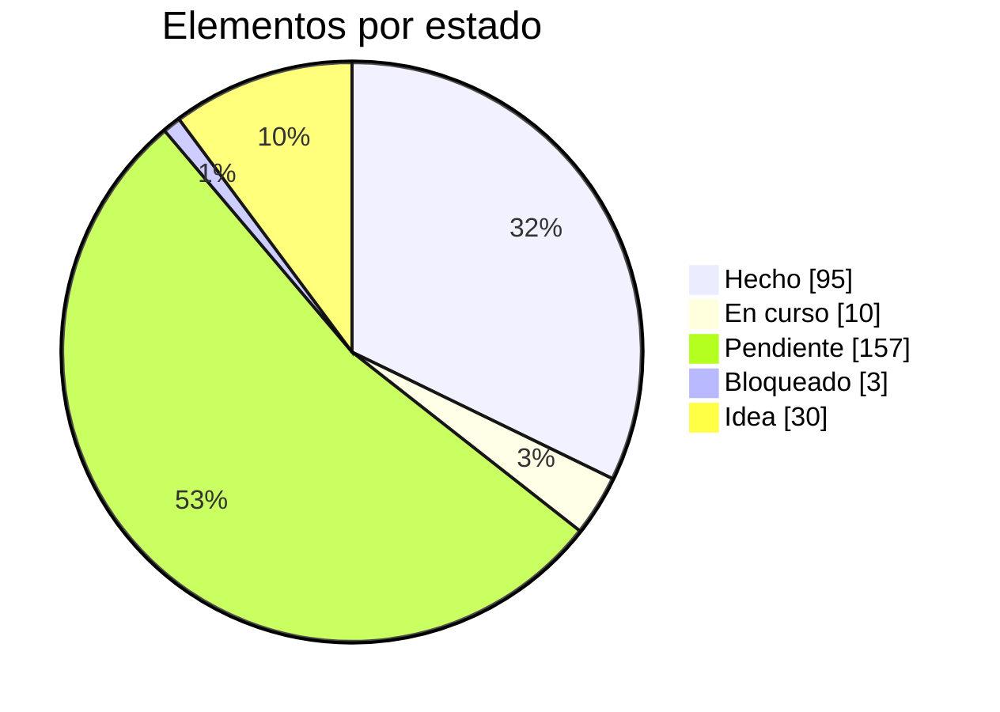

<!-- Generado por tools/roadmap/roadmap.mjs desde docs/roadmap/roadmap.json. NO editar a mano. -->

# Hoja de ruta de BM27

> Actualizada: 2026-11-16. Se genera con `pnpm roadmap` a partir de [`roadmap/roadmap.json`](roadmap/roadmap.json); la CI falla si este archivo no coincide con los datos.
>
> **Cómo leer los porcentajes.** Cada tarea pequeña vale lo mismo. «Hecho» cuenta 100 %, «Pendiente» 0 % y «En curso» lo que estimen quien la lleva (es una **estimación**, no una medición). Las ideas y lo bloqueado cuentan 0 %. «Ideas sin clasificar» no entra en el total.

## Resumen

**Avance global: 34 %** `██████████░░░░░░░░░░░░░░░░░░░░`  (295 elementos)

## Fases (del punto A al Z)

```mermaid
flowchart LR
  F0["F0 Fundaciones<br/>85 %"]
  F1["F1 Primera versión jugable<br/>52 %"]
  F2["F2 Profundidad de gestión<br/>0 %"]
  F3["F3 Mundo, datos y mods<br/>0 %"]
  F4["F4 Presentación<br/>0 %"]
  F5["F5 Distribución<br/>16 %"]
  F6["F6 Pulido y lanzamiento<br/>0 %"]
  F0 --> F1 --> F2 --> F3 --> F4 --> F5 --> F6
  classDef hecho fill:#2da44e,color:#fff,stroke:#1a7f37;
  classDef curso fill:#bf8700,color:#fff,stroke:#7d4e00;
  classDef pendiente fill:#eaeef2,color:#24292f,stroke:#8c959f;
  class F0 curso;
  class F1 curso;
  class F2 pendiente;
  class F3 pendiente;
  class F4 pendiente;
  class F5 curso;
  class F6 pendiente;
```

| Fase | Avance | | Hecho | Qué significa |
| --- | ---: | --- | ---: | --- |
| **F0 Fundaciones** | 85 % | `█████████████████░░░` | 79/98 | Núcleo determinista, motor de partido, mundo persistente, mercado y finanzas, y la forma de trabajar de los dos agentes. |
| **F1 Primera versión jugable** | 52 % | `██████████░░░░░░░░░░` | 15/31 | Que el propietario pueda jugar de principio a fin una temporada y varias más sin tocar una terminal, con consultas básicas del mundo. |
| **F2 Profundidad de gestión** | 0 % | `░░░░░░░░░░░░░░░░░░░░` | 0/64 | Traspasos, cantera y ojeadores, economía con decisiones, entrenador rival con criterio, motor de partido completo. |
| **F3 Mundo, datos y mods** | 0 % | `░░░░░░░░░░░░░░░░░░░░` | 0/51 | Calibración con datos contrastados, paquetes de datos cargables, pirámide completa y otras competiciones. |
| **F4 Presentación** | 0 % | `░░░░░░░░░░░░░░░░░░░░` | 0/24 | Diseño visual, accesibilidad, partido en 2D, narración, sonido y varios idiomas. |
| **F5 Distribución** | 16 % | `███░░░░░░░░░░░░░░░░░` | 1/10 | Instalador de escritorio, versiones alfa y beta en GitHub, actualización automática, firma y otras plataformas. |
| **F6 Pulido y lanzamiento** | 0 % | `░░░░░░░░░░░░░░░░░░░░` | 0/17 | Tutorial, equilibrio final, documentación, comunidad y lanzamiento. |

## Áreas del juego

| Área | Avance | | ✅ | 🔄 | ⬜ | ⛔ | 💡 | Para qué sirve |
| --- | ---: | --- | ---: | ---: | ---: | ---: | ---: | --- |
| **Núcleo y arquitectura** | 53 % | `███████████░░░░░░░░░` | 8 | 1 | 7 | 0 | 0 | La base técnica que hace fiable todo lo demás: reproducible, sin interfaz, validada por esquemas. |
| **Motor de partido** | 51 % | `██████████░░░░░░░░░░` | 24 | 2 | 20 | 0 | 3 | Que cada partido se juegue posesión a posesión con reglas de baloncesto reales y que las tácticas tengan efecto medible. |
| **Jugadores** | 39 % | `████████░░░░░░░░░░░░` | 9 | 0 | 12 | 0 | 2 | Personas con atributos, carrera, potencial y personalidad que el usuario descubre y gestiona. |
| **Clubes** | 27 % | `█████░░░░░░░░░░░░░░░` | 4 | 0 | 9 | 0 | 2 | El club como organización: plantilla, reputación, afición, estadio y objetivos. |
| **Entrenadores y personal técnico** | 0 % | `░░░░░░░░░░░░░░░░░░░░` | 0 | 0 | 9 | 0 | 0 | Las personas que dirigen y apoyan al equipo, con efecto real en el juego. |
| **Competiciones** | 35 % | `███████░░░░░░░░░░░░░` | 6 | 0 | 9 | 0 | 2 | Pirámide masculina española en cuatro niveles como datos, ampliable sin tocar el motor. |
| **Mercado y contratos** | 37 % | `███████░░░░░░░░░░░░░` | 5 | 1 | 7 | 0 | 3 | Cómo se mueven los jugadores y el dinero entre clubes, con reglas distintas según la liga. |
| **Finanzas** | 31 % | `██████░░░░░░░░░░░░░░` | 4 | 0 | 8 | 0 | 1 | El dinero como restricción real: ingresos, gastos, presupuestos y consecuencias de gestionar mal. |
| **Gestión del usuario** | 36 % | `███████░░░░░░░░░░░░░` | 5 | 0 | 7 | 0 | 2 | Lo que el jugador puede hacer: decidir, delegar y entender las consecuencias. |
| **Mundo persistente** | 30 % | `██████░░░░░░░░░░░░░░` | 3 | 0 | 6 | 0 | 1 | Un mundo que sigue vivo y estable durante decenas de temporadas, sin inflarse ni hundirse. |
| **Datos, mods e idiomas** | 15 % | `███░░░░░░░░░░░░░░░░░` | 2 | 0 | 9 | 0 | 2 | Reglamentos, competiciones y contenido como datos: añadir una liga no debe tocar el motor. |
| **Guardado y persistencia** | 37 % | `███████░░░░░░░░░░░░░` | 3 | 1 | 6 | 0 | 0 | Las partidas no se pierden, son compactas y se pueden recuperar. |
| **Interfaz web** | 25 % | `█████░░░░░░░░░░░░░░░` | 7 | 0 | 21 | 0 | 0 | La cara del juego: clara, rápida y accesible. |
| **Visualización del partido** | 11 % | `██░░░░░░░░░░░░░░░░░░` | 1 | 0 | 6 | 0 | 2 | Ver el partido, no solo leerlo, derivado siempre del registro de eventos. |
| **Aplicación de escritorio y distribución** | 13 % | `███░░░░░░░░░░░░░░░░░` | 1 | 1 | 7 | 1 | 2 | Que el propietario instale y actualice el juego sin pasar por GitHub. |
| **Calidad, pruebas y herramientas** | 43 % | `█████████░░░░░░░░░░░` | 5 | 1 | 5 | 0 | 2 | Poder fiarse de lo construido y detectar a tiempo lo que se rompe. |
| **Proceso y coordinación** | 65 % | `█████████████░░░░░░░` | 5 | 2 | 1 | 2 | 0 | Que dos agentes y un propietario no programador trabajen sin estorbarse. |
| **Documentación y comunidad** | 23 % | `█████░░░░░░░░░░░░░░░` | 2 | 1 | 5 | 0 | 3 | Que cualquiera entienda el juego, el proyecto y cómo ampliarlo. |
| **Producto, legal y negocio** | 14 % | `███░░░░░░░░░░░░░░░░░` | 1 | 0 | 3 | 0 | 3 | Decisiones que no son código pero condicionan el lanzamiento. |
| **Ideas sin clasificar _(no cuenta)_** | 0 % | `░░░░░░░░░░░░░░░░░░░░` | 0 | 0 | 0 | 0 | 8 | Aparcamiento de ideas que aún no son tareas. No cuentan en el porcentaje. |

## Quién trabaja en qué ahora

Los agentes solo trabajan cuando el propietario lo autoriza (D-052); esto refleja el último estado conocido.

### Claude Code

| Estado | Elemento | Área | Avance | Enlace |
| --- | --- | --- | ---: | --- |
| 🔄 En curso | Excepción del salario mínimo solo para llegar al mínimo de plantilla | Mercado y contratos | 90 % | [#26](https://github.com/dariogea/BM27/issues/26) |
| 🔄 En curso | Publicación en Releases de GitHub (preversión) | Aplicación de escritorio y distribución | 60 % | [#22](https://github.com/dariogea/BM27/issues/22) |
| ⬜ Pendiente | Versión 0.1.0-alpha.1 publicada | Aplicación de escritorio y distribución | — | — |
| ⬜ Pendiente | La etiqueta de la Release corresponde al código compilado | Aplicación de escritorio y distribución | — | [#39](https://github.com/dariogea/BM27/issues/39) |
| 🔄 En curso | Trabajo bajo autorización del propietario | Proceso y coordinación | 80 % | — |
| 🔄 En curso | Esta hoja de ruta, generada y comprobada en CI | Proceso y coordinación | 70 % | — |
| ⬜ Pendiente | Política de fusión sin huecos conocidos | Proceso y coordinación | — | [#36](https://github.com/dariogea/BM27/issues/36) |

### Codex

| Estado | Elemento | Área | Avance | Enlace |
| --- | --- | --- | ---: | --- |
| 🔄 En curso | Repeticiones verificables tras recargar | Guardado y persistencia | 70 % | [#27](https://github.com/dariogea/BM27/issues/27) |
| 🔄 En curso | Auditoría independiente de main | Calidad, pruebas y herramientas | 60 % | [#28](https://github.com/dariogea/BM27/issues/28) |

### En curso sin dueño asignado

| Estado | Elemento | Área | Avance | Enlace |
| --- | --- | --- | ---: | --- |
| 🔄 En curso | API pública del núcleo estable y documentada | Núcleo y arquitectura | 40 % | — |
| 🔄 En curso | Cambios con reglas fijas (margen de rendimiento y faltas) | Motor de partido | 50 % | — |
| 🔄 En curso | Variantes de reglamento por competición (tiempo, faltas, prórroga) | Motor de partido | 50 % | — |
| 🔄 En curso | README con cómo probarlo | Documentación y comunidad | 50 % | — |

### Bloqueado (necesita una decisión o un paso del propietario)

- ⛔ **Actualización automática desde el propio juego** (Aplicación de escritorio y distribución) — Depende de decidir si hay repositorio público solo para instaladores (#22).
- ⛔ **Protección de la rama main** (Proceso y coordinación) — Paso del propietario en GitHub. [#24](https://github.com/dariogea/BM27/issues/24)
- ⛔ **Entorno de Codex en la nube** (Proceso y coordinación) — Paso del propietario. [#24](https://github.com/dariogea/BM27/issues/24)

## Detalle completo por área

Leyenda: ✅ hecho · 🔄 en curso · ⬜ pendiente · ⛔ bloqueado · 💡 idea. Entre paréntesis: fase, avance (si está en curso), dueño y enlace al Issue.

<b>Núcleo y arquitectura</b> — 53 % `██████░░░░░░`

_La base técnica que hace fiable todo lo demás: reproducible, sin interfaz, validada por esquemas._

- ✅ Núcleo sin interfaz (headless, sin DOM) (`F0`) — _Pilar 3; lo comprueba ESLint y un test._
- ✅ Generador de azar con semilla (xoshiro128**) (`F0`)
- ✅ Semilla propia por partido, independiente del orden (`F0`)
- ✅ Huella SHA-256 y JSON canónico (`F0`)
- ✅ Esquemas zod y JSON Schema exportados (`F0`)
- ✅ schemaVersion y migraciones encadenadas (v0 a v5) (`F0`)
- 🔄 API pública del núcleo estable y documentada (`F0` · 40 %) — _Hay API pero sin documento de referencia._
- ✅ Prohibición de Math.random en el núcleo (test) (`F0`)
- ⬜ Errores del núcleo con códigos y mensajes legibles (`F0`)
- ⬜ Simulación en paralelo con varios Workers (`F2` · [#18](https://github.com/dariogea/BM27/issues/18)) — _T-019._
- ⬜ Reducir copias del universo y coste por partido (`F2` · [#18](https://github.com/dariogea/BM27/issues/18))
- ⬜ Registro (log) de depuración del núcleo (`F0`)
- ✅ Medición de memoria en las pruebas de rendimiento (`F0`)
- ⬜ Límites de tamaño del universo (`F0`)
- ⬜ Cancelación y progreso de simulaciones largas (`F2`)
- ⬜ Referencia de la API para quien haga mods (`F3`)

<b>Motor de partido</b> — 51 % `██████░░░░░░`

_Que cada partido se juegue posesión a posesión con reglas de baloncesto reales y que las tácticas tengan efecto medible._

- **Estructura del partido** — 60 %
  - ✅ Simulación por posesiones (`F0`)
  - ✅ Cuatro periodos y reloj de partido (`F0`)
  - ✅ Reloj de posesión (24 s) y reinicio a 14 s (`F0`)
  - ✅ Prórrogas hasta desempatar (`F0`)
  - ✅ Registro de eventos por posesión (fuente de todo) (`F0`)
  - ✅ Box score derivado del registro (`F0`)
  - ⬜ Saltos entre dos y posesión alterna (`F2` · [#11](https://github.com/dariogea/BM27/issues/11)) — _T-012._
  - ⬜ Reglas de 8 y 5 segundos, campo atrás, tres segundos (`F2`)
  - ⬜ Interferencia y goaltending (`F2`)
  - 💡 Revisión de jugadas arbitral (si el reglamento la admite) (`F3`)
- **Acciones de juego** — 70 %
  - ✅ Tipos de jugada (play types): pick and roll, aislamiento, poste, tiro tras pase, cortes, bloqueos sin balón, transición, rebote ofensivo (`F0`)
  - ✅ Zonas de tiro con coordenadas (`F0`)
  - ✅ Tiros de dos, de tres y tiros libres (`F0`)
  - ✅ Rebotes ofensivos y defensivos (`F0`)
  - ✅ Pérdidas, robos y tapones (`F0`)
  - ✅ Asistencias (`F0`)
  - ✅ Tiros con falta y canastas más uno (`F0`) — _Versión simple; sin variedad de finalizaciones._
  - ⬜ Contraataques con ventaja numérica (`F2`)
  - ⬜ Mates, bandejas y variedad de finalizaciones (`F2`)
  - ⬜ Posiciones reales de los jugadores en pista (`F4`) — _Necesario para un visualizador 2D fiel._
- **Faltas y disciplina** — 33 %
  - ✅ Faltas personales y límite de faltas por jugador (`F0`)
  - ✅ Faltas de equipo y bonus (`F0`)
  - ⬜ Faltas técnicas (`F2` · [#11](https://github.com/dariogea/BM27/issues/11))
  - ⬜ Faltas antideportivas y descalificantes (`F2` · [#11](https://github.com/dariogea/BM27/issues/11))
  - 💡 Árbitros con criterio propio (estricto o permisivo) (`F3`)
  - 💡 Sanciones y suspensiones fuera de la pista (`F3`)
- **Defensa y tácticas** — 50 %
  - ✅ Defensa individual y coberturas del bloqueo directo (`F0`)
  - ✅ Defensas en zona y presión (`F0`)
  - ✅ Ritmo de juego y plan ofensivo (`F0`)
  - ✅ Efecto de las tácticas verificado con tests de equilibrio (`F0`)
  - ⬜ Ayudas defensivas y rotaciones (`F2`)
  - ⬜ Jugadas ensayadas y sistemas de ataque propios (`F2`)
  - ⬜ Ajustes tácticos durante el partido (`F2` · [#10](https://github.com/dariogea/BM27/issues/10)) — _T-011._
  - ⬜ Planes específicos contra un rival (`F2`)
- **Rotaciones, energía y entrenador de partido** — 39 %
  - ✅ Quinteto inicial y plan de minutos (`F0`) — _El entrenador es un PLACEHOLDER con reglas fijas._
  - ✅ Fatiga y recuperación en el banquillo (`F0`)
  - 🔄 Cambios con reglas fijas (margen de rendimiento y faltas) (`F0` · 50 %) — _Parte del entrenador PLACEHOLDER._
  - ⬜ Entrenador con criterio propio (`F2` · [#10](https://github.com/dariogea/BM27/issues/10)) — _T-011._
  - ⬜ Tiempos muertos (`F2` · [#11](https://github.com/dariogea/BM27/issues/11))
  - ⬜ Lesiones durante el partido (`F2` · [#11](https://github.com/dariogea/BM27/issues/11))
  - ⬜ Rachas y momento del partido (`F2`)
  - ✅ Ventaja de jugar en casa (bonus de tiro) (`F0`)
  - ⬜ Efecto del público y del ambiente del pabellón (`F2`)
- **Estadísticas y calibración** — 33 %
  - ✅ Calibración con bandas de referencia (pnpm calibrate) (`F0`) — _Las bandas son de conocimiento general, no datos verificados._
  - ⬜ Estadísticas avanzadas (valoración, eficiencia, +/-) (`F2`)
  - ⬜ Calibración con datos reales verificados (`F3` · [#20](https://github.com/dariogea/BM27/issues/20)) — _T-021. Decisión de fuentes pendiente del propietario (#24)._
- **Reglamentos distintos** — 50 %
  - ✅ Reglamento como dato validado por esquema (`F0`)
  - 🔄 Variantes de reglamento por competición (tiempo, faltas, prórroga) (`F0` · 50 %) — _Hay dos reglamentos como datos._
  - ⬜ Reglamento con cuartos de otra duración o con mitades (`F3`)

<b>Jugadores</b> — 39 % `█████░░░░░░░`

_Personas con atributos, carrera, potencial y personalidad que el usuario descubre y gestiona._

- ✅ 20 atributos técnicos, físicos y mentales (`F0`)
- ✅ Posiciones y roles (`F0`)
- ✅ Edad, desarrollo y declive (`F0`)
- ✅ Potencial oculto (`F0`)
- ✅ Retirada de los jugadores (`F0`)
- ✅ Generación de jugadores con nombres ficticios (`F0`)
- ✅ Contrato y salario (`F0`)
- ✅ Estadísticas por temporada (`F0`)
- ⬜ Potencial mostrado como estimación (ojeadores) (`F2` · [#13](https://github.com/dariogea/BM27/issues/13)) — _T-014. Decisión pendiente del propietario (#24)._
- ⬜ Lesiones: tipos, duración y recaídas (`F2` · [#11](https://github.com/dariogea/BM27/issues/11))
- ⬜ Personalidad y moral (`F2`)
- ⬜ Ambición, lealtad y relación con el club (`F2`)
- ⬜ Rasgos especiales (clutch, trabajador, frágil…) (`F2`)
- ⬜ Entrenamiento individual y foco de mejora (`F2`)
- ⬜ Desarrollo según minutos jugados (`F2`)
- ⬜ Nacionalidad, cupos y jugadores extranjeros (`F3`)
- ✅ Altura con efecto real en el juego (`F0`)
- ⬜ Envergadura y físico fino (`F2`)
- ⬜ Forma física entre partidos (`F2`)
- 💡 Compañeros de equipo y química (`F3`)
- 💡 Retirada del número y homenajes (`F6`)
- ⬜ Salón de la fama (`F3`)
- ⬜ Historial completo de la carrera de cada jugador (`F1` · [#14](https://github.com/dariogea/BM27/issues/14)) — _T-015._

<b>Clubes</b> — 27 % `███░░░░░░░░░`

_El club como organización: plantilla, reputación, afición, estadio y objetivos._

- ✅ Plantilla con mínimo y máximo por competición (`F0`)
- ✅ Reputación y su regresión a la media (`F0`)
- ✅ Tácticas y alineación por club (`F0`)
- ⬜ Instalaciones del club (`F2` · [#12](https://github.com/dariogea/BM27/issues/12)) — _T-013._
- ✅ Asistencia al pabellón según reputación (`F0`) — _Versión simple._
- ⬜ Afición: fidelidad y crecimiento (`F2`)
- ⬜ Estadio: aforo y ambiente (`F2`)
- ⬜ Directiva con objetivos de temporada (`F2`)
- ⬜ Confianza de la directiva y despido del entrenador (`F2`)
- ⬜ Cantera propia por club (`F2` · [#13](https://github.com/dariogea/BM27/issues/13)) — _T-014._
- 💡 Equipos filiales (`F3`)
- ⬜ Rivalidades históricas (`F3`)
- ⬜ Escudo, colores y equipación (datos) (`F4`)
- ⬜ Historia del club: títulos, récords y leyendas (`F3`)
- 💡 Fundación, desaparición y fusión de clubes (`F3`)

<b>Entrenadores y personal técnico</b> — 0 % `░░░░░░░░░░░░`

_Las personas que dirigen y apoyan al equipo, con efecto real en el juego._

- ⬜ Entrenador rival con criterio (sustituye al PLACEHOLDER) (`F2` · [#10](https://github.com/dariogea/BM27/issues/10)) — _T-011._
- ⬜ Entrenador como dato del equipo (atributos, filosofía) (`F2`)
- ⬜ Ayudantes y especialistas (`F2`)
- ⬜ Preparador físico: efecto en fatiga y lesiones (`F2`)
- ⬜ Servicio médico: recuperación de lesiones (`F2`)
- ⬜ Ojeadores: calidad y cobertura (`F2` · [#13](https://github.com/dariogea/BM27/issues/13))
- ⬜ Mercado de entrenadores y contratos de personal (`F3`)
- ⬜ Carrera del usuario como entrenador (`F3`)
- ⬜ Ofertas de otros clubes al entrenador (`F3`)

<b>Competiciones</b> — 35 % `████░░░░░░░░`

_Pirámide masculina española en cuatro niveles como datos, ampliable sin tocar el motor._

- ✅ Liga regular todos contra todos (`F0`)
- ✅ Playoffs por el título (`F0`)
- ✅ Ascensos y descensos entre niveles (`F0`)
- ✅ Cuatro niveles con unos 200 equipos (`F0`)
- ✅ Clasificación y desempates (`F0`)
- ✅ Generador de calendario (`F0`)
- ⬜ Copa nacional (`F3`)
- ⬜ Supercopa (`F3`)
- ⬜ Competición continental de clubes (`F3`)
- ⬜ Selecciones nacionales y ventanas internacionales (`F3`)
- ⬜ Formatos mixtos (fase de grupos y eliminatoria) (`F3`)
- ⬜ Ligas de otros países como paquetes de datos (`F3` · [#21](https://github.com/dariogea/BM27/issues/21))
- 💡 Niveles inferiores (amateur y formativos) (`F3`)
- ⬜ Playoffs de ascenso con formato propio (`F0`) — _No verificado: hoy solo se confirma el playoff por el título._
- ⬜ Calendario con descansos y viajes (`F2`)
- 💡 Partidos aplazados y suspendidos (`F3`)
- ⬜ Palmarés de cada competición (`F1` · [#14](https://github.com/dariogea/BM27/issues/14))

<b>Mercado y contratos</b> — 37 % `████░░░░░░░░`

_Cómo se mueven los jugadores y el dinero entre clubes, con reglas distintas según la liga._

- ✅ Agentes libres: fichajes (`F0`)
- ✅ Renovaciones y contratos cumplidos (`F0`)
- ✅ Tope salarial y salario mínimo (`F0`)
- ✅ Liberar jugadores con indemnización (`F0`) — _Regla de indemnización pendiente de confirmar por el propietario (#24)._
- 🔄 Excepción del salario mínimo solo para llegar al mínimo de plantilla (`F0` · 90 % · @claude · [#26](https://github.com/dariogea/BM27/issues/26)) — _PR #38 abierto._
- ✅ Mercado de la IA para los clubes rivales (`F0`)
- ⬜ Traspasos entre clubes con dinero y negociación (`F2` · [#8](https://github.com/dariogea/BM27/issues/8)) — _T-010._
- ⬜ Ofertas de rivales por jugadores del usuario (`F2` · [#8](https://github.com/dariogea/BM27/issues/8))
- ⬜ Cláusulas de rescisión (`F2`)
- ⬜ Cesiones (`F3`)
- 💡 Agentes de jugadores y comisiones (`F3`)
- ⬜ Bonus por objetivos en los contratos (`F2`)
- 💡 Ventanas de mercado con fechas (`F3`)
- ⬜ Rumores y noticias de fichajes (`F3`)
- ⬜ Mercados distintos según la liga (topes, cupos, drafts) (`F3`)
- 💡 Draft de jóvenes (si el reglamento lo admite) (`F3`)

<b>Finanzas</b> — 31 % `████░░░░░░░░`

_El dinero como restricción real: ingresos, gastos, presupuestos y consecuencias de gestionar mal._

- ✅ Ingresos: televisión, patrocinadores y entradas (`F0`)
- ✅ Presupuesto salarial y descubierto (`F0`)
- ✅ Contabilidad exacta de transacciones (`F0`)
- ✅ Regresión de la reputación y efecto en ingresos (`F0`)
- ⬜ Escala monetaria realista (`F3` · [#20](https://github.com/dariogea/BM27/issues/20)) — _Las cifras actuales son inventadas (T-021)._
- ⬜ Precio de las entradas (`F2` · [#12](https://github.com/dariogea/BM27/issues/12)) — _T-013._
- ⬜ Patrocinadores con ofertas y condiciones (`F2` · [#12](https://github.com/dariogea/BM27/issues/12))
- ⬜ Inversión en instalaciones y cantera (`F2` · [#12](https://github.com/dariogea/BM27/issues/12))
- ⬜ Quiebra, licencias y sanciones (`F2` · [#12](https://github.com/dariogea/BM27/issues/12))
- ⬜ Venta de camisetas y merchandising (`F3`)
- ⬜ Reparto de derechos entre clubes (`F3`)
- 💡 Juego limpio financiero (`F3`)
- ⬜ Informes de finanzas y previsión (`F2`)

<b>Gestión del usuario</b> — 36 % `████░░░░░░░░`

_Lo que el jugador puede hacer: decidir, delegar y entender las consecuencias._

- ✅ Elegir equipo y empezar partida (`F1`)
- ✅ Jugar jornadas y temporadas (`F1`)
- ✅ Cambiar tácticas y alineación propias (`F1`)
- ✅ Fichar, renovar y liberar (`F1`)
- ✅ Ver finanzas del club (`F1`)
- ⬜ Avanzar día a día con calendario propio (`F1`)
- ⬜ Bandeja de mensajes y noticias (`F2`)
- ⬜ Delegar tareas en ayudantes (`F2`)
- 💡 Asistente que sugiere decisiones (`F3`)
- ⬜ Objetivos y evaluación de la directiva (`F2`)
- ⬜ Entrenamientos semanales (`F2`)
- 💡 Conversaciones con jugadores (`F3`)
- ⬜ Modo carrera: cambiar de club (`F3`)
- ⬜ Dificultad y asistencias configurables (`F6`)

<b>Mundo persistente</b> — 30 % `████░░░░░░░░`

_Un mundo que sigue vivo y estable durante decenas de temporadas, sin inflarse ni hundirse._

- ✅ Temporada paso a paso con fase de mercado (`F0`)
- ✅ Envejecimiento, retiradas y relevo con jóvenes (`F0`)
- ✅ Estabilidad medida a 30 temporadas (pnpm stability) (`F0`)
- ⬜ Las estrellas del nivel uno no se aplanan con los años (`F2` · [#19](https://github.com/dariogea/BM27/issues/19)) — _T-020._
- ⬜ Historial de campeones, ascensos y descensos (`F1` · [#14](https://github.com/dariogea/BM27/issues/14))
- ⬜ Récords históricos de liga y club (`F3`)
- ⬜ Noticias del mundo (retiradas, récords, quiebras) (`F3`)
- ⬜ Cantera real en lugar del relleno automático (`F2` · [#13](https://github.com/dariogea/BM27/issues/13))
- ⬜ Estabilidad a 100 temporadas (`F3`)
- 💡 Evolución del juego (cambios de reglas con los años) (`F3`)

<b>Datos, mods e idiomas</b> — 15 % `██░░░░░░░░░░`

_Reglamentos, competiciones y contenido como datos: añadir una liga no debe tocar el motor._

- ✅ Esquemas validados con zod y JSON Schema (`F0`)
- ✅ Universo inicial de España masculina como datos (`F0`)
- ⬜ Cargador de paquetes de datos con errores legibles (`F3` · [#21](https://github.com/dariogea/BM27/issues/21)) — _T-022._
- ⬜ Versionado y compatibilidad de paquetes (`F3` · [#21](https://github.com/dariogea/BM27/issues/21))
- ⬜ Elegir paquete al crear el universo (web y CLI) (`F3` · [#21](https://github.com/dariogea/BM27/issues/21))
- ⬜ Ejemplo mínimo: liga de 8 equipos (`F3` · [#21](https://github.com/dariogea/BM27/issues/21))
- ⬜ Guía para crear mods (`F3`)
- 💡 Editor de datos dentro del juego (`F3`)
- ⬜ Generador de nombres por país y región (`F3`)
- ⬜ Textos traducibles (i18n) (`F4`)
- ⬜ Segundo idioma (`F4`)
- 💡 Importar datos propios del usuario sin traer datos reales (`F3`)
- ⬜ Comprobación automática de nombres reales prohibidos (`F3`)

<b>Guardado y persistencia</b> — 37 % `████░░░░░░░░`

_Las partidas no se pierden, son compactas y se pueden recuperar._

- ✅ Guardado en archivo JSON con comprobación (`F1`)
- ✅ Interfaz SaveStore con migraciones (`F1`)
- ✅ Guardar y cargar en el escritorio mediante diálogos (`F1`)
- ⬜ Varias ranuras con nombre dentro de la aplicación (`F1` · [#16](https://github.com/dariogea/BM27/issues/16)) — _T-017._
- ⬜ Guardado automático al cerrar temporada (`F1` · [#16](https://github.com/dariogea/BM27/issues/16))
- ⬜ Política de historial y compactación (`F2` · [#17](https://github.com/dariogea/BM27/issues/17)) — _T-018. Decisión del propietario pendiente (#24)._
- ⬜ Compresión del archivo (`F2` · [#17](https://github.com/dariogea/BM27/issues/17))
- ⬜ Recuperación ante archivo corrupto (`F1` · [#16](https://github.com/dariogea/BM27/issues/16))
- ⬜ Copias de seguridad automáticas (`F2`)
- 🔄 Repeticiones verificables tras recargar (`F1` · 70 % · @codex · [#27](https://github.com/dariogea/BM27/issues/27)) — _PR #32 de Codex._

<b>Interfaz web</b> — 25 % `███░░░░░░░░░`

_La cara del juego: clara, rápida y accesible._

- **Pantallas existentes** — 100 %
  - ✅ Generar universo y elegir equipo (`F1`)
  - ✅ Clasificación y calendario (`F1`)
  - ✅ Detalle del partido (box score y narración) (`F1`)
  - ✅ Plantilla y tácticas (`F1`)
  - ✅ Mercado de agentes libres (`F1`)
  - ✅ Finanzas (`F1`)
  - ✅ Guardar y cargar (`F1`)
- **Pantallas por hacer** — 0 %
  - ⬜ Plantilla y tácticas de cualquier equipo (`F1` · [#14](https://github.com/dariogea/BM27/issues/14))
  - ⬜ Ficha de jugador completa (`F1` · [#14](https://github.com/dariogea/BM27/issues/14))
  - ⬜ Líderes estadísticos (`F1` · [#14](https://github.com/dariogea/BM27/issues/14))
  - ⬜ Palmarés (`F1` · [#14](https://github.com/dariogea/BM27/issues/14))
  - ⬜ Buscador de jugadores y equipos (`F1` · [#14](https://github.com/dariogea/BM27/issues/14))
  - ⬜ Pantalla de inicio que explique cómo se juega (`F4` · [#23](https://github.com/dariogea/BM27/issues/23))
  - ⬜ Mercado de traspasos (`F2` · [#8](https://github.com/dariogea/BM27/issues/8))
  - ⬜ Cantera y ojeadores (`F2` · [#13](https://github.com/dariogea/BM27/issues/13))
  - ⬜ Bandeja de mensajes (`F2`)
  - ⬜ Instalaciones y patrocinadores (`F2` · [#12](https://github.com/dariogea/BM27/issues/12))
  - ⬜ Ajustes del juego (`F4`)
  - ⬜ Ayuda y glosario (`F4`)
- **Calidad de la interfaz** — 0 %
  - ⬜ Sistema de diseño con modo claro y oscuro (`F4` · [#23](https://github.com/dariogea/BM27/issues/23)) — _T-024._
  - ⬜ Adaptación a móvil (`F4` · [#23](https://github.com/dariogea/BM27/issues/23))
  - ⬜ Accesibilidad (contraste, teclado, lectores de pantalla) (`F4` · [#23](https://github.com/dariogea/BM27/issues/23))
  - ⬜ Tablas ordenables y filtros (`F4`)
  - ⬜ Atajos de teclado (`F4`)
  - ⬜ Explicaciones emergentes (tooltips) de cada atributo (`F4`)
  - ⬜ Gráficos de evolución (jugador, club, finanzas) (`F4`)
  - ⬜ Rendimiento con miles de filas (`F4`)
- ⬜ Versión jugable sin instalar nada (página única) (`F1` · [#9](https://github.com/dariogea/BM27/issues/9)) — _T-009. Plan B: la web ya se puede abrir; falta el archivo único._

<b>Visualización del partido</b> — 11 % `█░░░░░░░░░░░`

_Ver el partido, no solo leerlo, derivado siempre del registro de eventos._

- ✅ Narración textual jugada a jugada (`F0`)
- ⬜ Pista 2D con los diez jugadores (`F4` · [#15](https://github.com/dariogea/BM27/issues/15)) — _T-016._
- ⬜ Mapa de tiros del partido (`F4` · [#15](https://github.com/dariogea/BM27/issues/15))
- ⬜ Control de velocidad, pausa y salto de periodo (`F4` · [#15](https://github.com/dariogea/BM27/issues/15))
- ⬜ Modo ver en directo con opción de saltar (`F4` · [#15](https://github.com/dariogea/BM27/issues/15))
- ⬜ Estadísticas en vivo durante la reproducción (`F4`)
- ⬜ Repeticiones de jugadas destacadas (`F4`)
- 💡 Sonido y ambiente (`F4`)
- 💡 Visualización 3D (`F4`) — _Fuera del alcance inicial._

<b>Aplicación de escritorio y distribución</b> — 13 % `██░░░░░░░░░░`

_Que el propietario instale y actualice el juego sin pasar por GitHub._

- ✅ Envoltorio Tauri 2 con instalador para Windows (`F5` · @claude · [#22](https://github.com/dariogea/BM27/issues/22)) — _Se compila en el Windows de GitHub; nadie lo ha ejecutado aún en un Windows real._
- 🔄 Publicación en Releases de GitHub (preversión) (`F5` · 60 % · @claude · [#22](https://github.com/dariogea/BM27/issues/22))
- ⬜ Versión 0.1.0-alpha.1 publicada (`F5` · @claude) — _Esperando autorización del propietario._
- ⬜ Canales alfa y beta (`F5`)
- ⛔ Actualización automática desde el propio juego (`F5`) — _Depende de decidir si hay repositorio público solo para instaladores (#22)._
- ⬜ Firma de código del instalador (`F5`) — _Sin firma Windows avisa (SmartScreen)._
- ⬜ La etiqueta de la Release corresponde al código compilado (`F5` · @claude · [#39](https://github.com/dariogea/BM27/issues/39)) — _Hallazgo de Codex._
- ⬜ Versión para macOS (`F5`)
- ⬜ Versión para Linux (`F5`)
- ⬜ Icono, pantalla de carga y nombre definitivos (`F6`)
- 💡 Informe de fallos opcional y respetuoso con la privacidad (`F6`)
- 💡 Publicación en una tienda (`F6`)

<b>Calidad, pruebas y herramientas</b> — 43 % `█████░░░░░░░`

_Poder fiarse de lo construido y detectar a tiempo lo que se rompe._

- ✅ Integración continua (lint, formato, tipos, tests, compilación) (`F0`)
- ✅ Más de 160 tests en Vitest (`F0`)
- ✅ Tests de determinismo y de equilibrio táctico (`F0`)
- ✅ Herramientas de línea de comandos: sim, bench, calibrar, estabilidad (`F0`)
- ✅ Informes de mediciones en docs/benchmarks (`F0`)
- 🔄 Auditoría independiente de main (`F0` · 60 % · @codex · [#28](https://github.com/dariogea/BM27/issues/28)) — _Informe de Codex en revisión._
- ⬜ Pruebas de interfaz en navegador automatizado (`F1`)
- ⬜ Pruebas de accesibilidad automáticas (`F4`)
- ⬜ Medición de cobertura de tests (`F0`)
- 💡 Pruebas de generación aleatoria (fuzzing) del motor (`F0`)
- ⬜ Pruebas de regresión de los informes (comparación automática) (`F0`) — _Hoy las cifras se comparan a mano._
- 💡 Pruebas de rendimiento con umbral en CI (`F0`)
- ⬜ Estabilidad a varias semillas en CI (`F0`)

<b>Proceso y coordinación</b> — 65 % `████████░░░░`

_Que dos agentes y un propietario no programador trabajen sin estorbarse._

- ✅ Reglas permanentes en CLAUDE.md y AGENTS.md (`F0`)
- ✅ Tareas como Issues y etiquetas de agente (`F0`)
- ✅ Revisión cruzada entre agentes (`F0`)
- ✅ Fusión automática con la CI en verde (`F0`) — _Falta confirmar la primera fusión real con PR elegible (#38)._
- 🔄 Trabajo bajo autorización del propietario (`F0` · 80 % · @claude) — _PR de reglas pendiente de fusión manual._
- 🔄 Esta hoja de ruta, generada y comprobada en CI (`F0` · 70 % · @claude)
- ⬜ Política de fusión sin huecos conocidos (`F0` · @claude · [#36](https://github.com/dariogea/BM27/issues/36)) — _Hallazgos de Codex en #29._
- ⛔ Protección de la rama main (`F0` · [#24](https://github.com/dariogea/BM27/issues/24)) — _Paso del propietario en GitHub._
- ⛔ Entorno de Codex en la nube (`F0` · [#24](https://github.com/dariogea/BM27/issues/24)) — _Paso del propietario._
- ✅ Registro de decisiones al día (`F0`)

<b>Documentación y comunidad</b> — 23 % `███░░░░░░░░░`

_Que cualquiera entienda el juego, el proyecto y cómo ampliarlo._

- ✅ Documentación técnica (arquitectura, tácticas, escritorio) (`F0`)
- ✅ Estado del proyecto y decisiones (`F0`)
- 🔄 README con cómo probarlo (`F1` · 50 %)
- ⬜ Guía del jugador (`F6`)
- ⬜ Tutorial dentro del juego (`F6`)
- ⬜ Guía de mods (`F3`)
- ⬜ Registro de cambios (changelog) por versión (`F5`)
- ⬜ Licencia del proyecto (`F6`)
- 💡 Página web del proyecto (`F6`)
- 💡 Canal de comunidad para pruebas y comentarios (`F6`)
- 💡 Capturas y vídeo de presentación (`F6`)

<b>Producto, legal y negocio</b> — 14 % `██░░░░░░░░░░`

_Decisiones que no son código pero condicionan el lanzamiento._

- ✅ Nombres reales prohibidos (pilar 7) (`F0`)
- ⬜ Nombre definitivo del juego (`F6`)
- ⬜ Licencia de código y de contenido (`F6`)
- 💡 Política de privacidad (si hay informes de fallos) (`F6`)
- 💡 Modelo de distribución (gratuito, de pago, tienda) (`F6`)
- 💡 Acuerdos con datos o marcas reales (`F6`) — _Hoy se evita por diseño._
- ⬜ Accesibilidad como requisito de lanzamiento (`F6`)

<b>Ideas sin clasificar</b> — 0 % `░░░░░░░░░░░░`

_Aparcamiento de ideas que aún no son tareas. No cuentan en el porcentaje._

- 💡 Modo multijugador en la misma partida (`F6`)
- 💡 Mundo en línea compartido (`F6`)
- 💡 Aplicación para móvil (`F6`)
- 💡 Retos y escenarios (salvar un club en quiebra) (`F6`)
- 💡 Logros (`F6`)
- 💡 Modo espectador: ver una liga sin gestionar (`F6`)
- 💡 Exportar estadísticas a hoja de cálculo (`F6`)
- 💡 Escenarios históricos jugables (`F6`)

